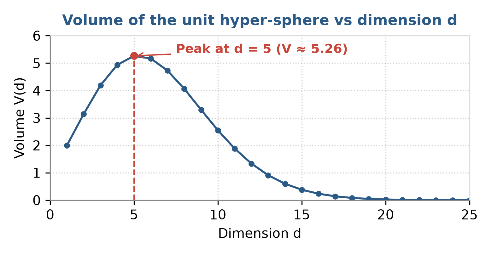
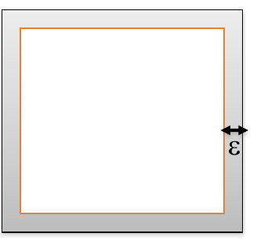

# Lecture 1: Data Exploration — High Dimensionality

**Course:** Deep Learning (S.-A. Berrani, ENSIA 2026–2027)  
**Topic:** The Curse of Dimensionality

---

## Core Idea & Notation

High-dimensional data (dimension $> 3$) escapes our intuition: distances, volumes and sample requirements behave in counter-intuitive ways. All these difficulties are called the **dimensionality curse**. Analysis, exploration, processing and management all become harder.

* $d$ --- dimension (number of variables); $n$ --- number of individuals (samples).
* $V_d(r)$ --- volume of a $d$-dimensional hyper-sphere of radius $r$; $\varepsilon$ --- width of the frame in the hyper-cube.
* $D_{\min}, D_{\max}$ --- distance from a query point to its nearest / furthest neighbour.

---

## 1. The Dimensionality Curse

* **Optimization:** difficulty of optimizing in high-dimensional spaces with *exhaustive* methods.
* **Statistics:** to keep the same reliability of an estimate, the number of samples must grow *exponentially* with $d$.

> **Identification.** More variables *and* more individuals $\Rightarrow$ less intuition, costly processing, harder analysis. Whenever a method needs "enough points in every region of space", expect the curse.

### 1.1 Quantities that Grow Exponentially with $d$
To cover or explore all possible configurations, the required effort grows exponentially with dimension:

| Quantity | Growth | Illustration |
| :--- | :--- | :--- |
| Binary combinations of $d$ variables | $2^d$ | Each new dimension doubles the number of states ($10 \to 10^3, 20 \to 10^6$) |

---

## 2. Loss of the Notion of Distance

When $d$ increases (under data uniformly distributed on all dimensions and independent):
* the distance to the **nearest** neighbour increases;
* the distance to the **furthest** neighbour increases;
* but $D_{\min}$ increases **faster** than $D_{\max}$.

**Limit:**
$$d \to \infty \implies D_{\min} \approx D_{\max} \qquad \left(\text{i.e. } \frac{D_{\max}}{D_{\min}} \to 1\right)$$

> **Consequence.** Nearest and furthest neighbours become indistinguishable: all points look equally far apart, so distance-based methods (nearest neighbour, clustering with Euclidean distance) lose meaning.

---

## 3. Volume of the Hyper-Sphere

  

**Formula:**
$$V_d(r) = \frac{\pi^{d/2}}{\Gamma(\frac{d}{2} + 1)} r^d$$

**Behavior (unit sphere, $r = 1$):**
* The volume initially increases, reaches its maximum at **$d = 5$** ($V_5(1) \approx 5.26$), and then rapidly collapses to $0$ as $d \to \infty$.
* Relative to the enclosing cube (side 2, volume $2^d$), the sphere's volume ratio drops exponentially to $0$:
  $$\lim_{d \to \infty} \frac{V_{\text{sphere}}}{V_{\text{cube}}} = 0$$
* *The volume of the cube concentrates in its corners.*

---

## 4. Exercise: Hyper-Cube and its Frame

  

**Setup:** points uniformly distributed in the hyper-cube $[0, 1]^d$. The **frame** (grey) is the set of points at distance $\le \varepsilon$ from the edge, $0 < \varepsilon < \frac{1}{2}$. The remaining inner hyper-cube is $[\varepsilon, 1 - \varepsilon]^d$, of side $1 - 2\varepsilon$.

**Probabilities (volume ratios):**
$$P(\text{inner}) = \frac{\text{Vol}([\varepsilon, 1-\varepsilon]^d)}{\text{Vol}([0, 1]^d)} = (1 - 2\varepsilon)^d, \qquad P(\text{frame}) = 1 - (1 - 2\varepsilon)^d$$

**Asymptotic limit ($d \to \infty$):**
Since $0 < 1 - 2\varepsilon < 1$, $(1 - 2\varepsilon)^d \to 0$, hence:
$$\lim_{d \to \infty} P(\text{frame}) = 1$$

**Example:** $\varepsilon = 0.05$ (so $1 - 2\varepsilon = 0.9$):
$$d = 2: 0.19, \quad d = 3: 0.27, \quad d = 10: 0.65, \quad d = 50: 0.995, \quad d = 100: 0.99997$$
Number of dimensions for $P(\text{frame}) \ge p$: $d \ge \frac{\ln(1 - p)}{\ln(1 - 2\varepsilon)}$; for $p = 0.99$: $d \ge 43.7$, i.e. $\mathbf{d \ge 44}$.

> **What we notice.** The probability curve increases and saturates at 1: in high dimension, **almost every point lies near the edge** (in the $\varepsilon$-frame) and the "centre" is empty. Data are sparse and isolated.

---

## 5. Solutions

| | **1. Reduce the variables** | **2. Reduce the instances** |
| :--- | :--- | :--- |
| **Idea** | Create new variables from the original ones while losing as little information as possible | Partition the dataset by grouping similar individuals |
| **Acts on** | Columns (features), $p \to q < p$ | Rows (individuals) |
| **Example** | **PCA** (Principal Component Analysis) | **Clustering** (unsupervised classification) |
