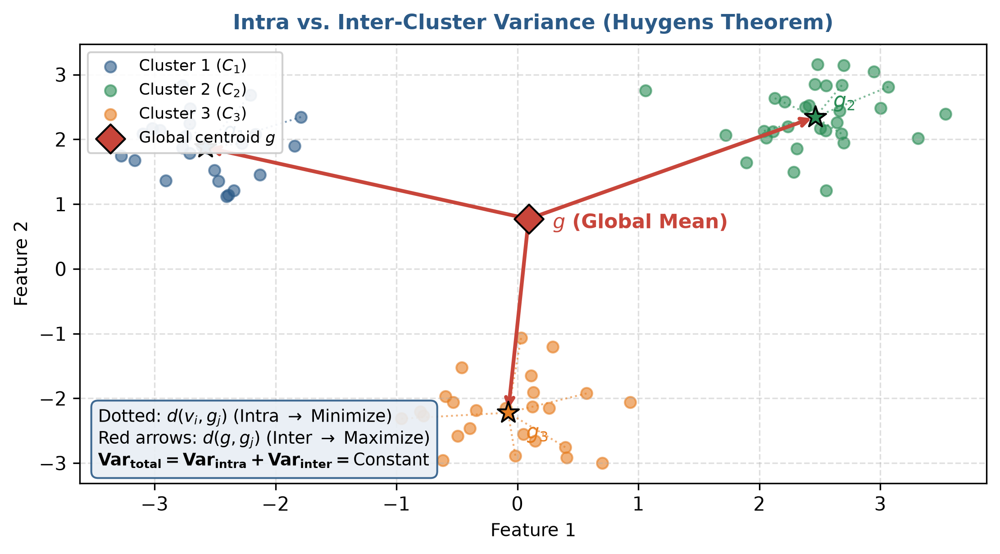
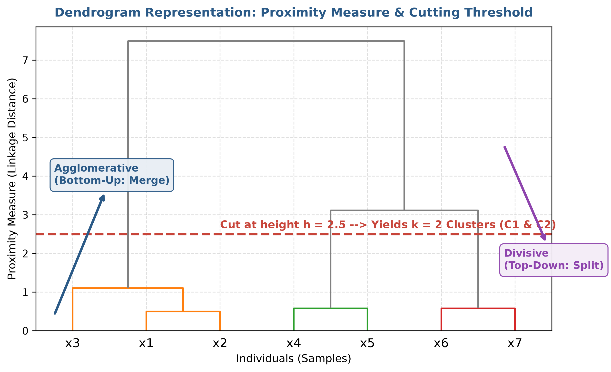
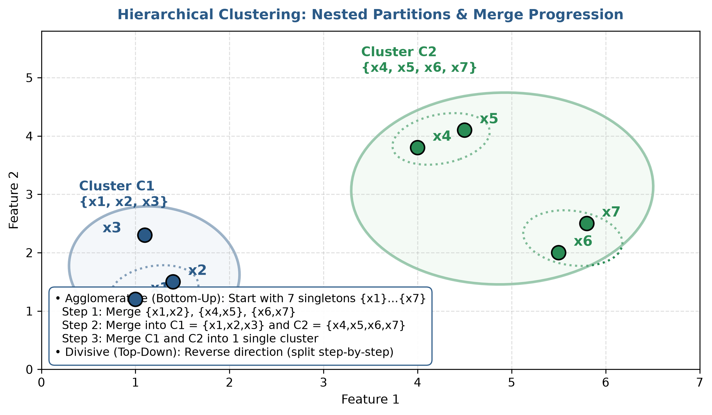
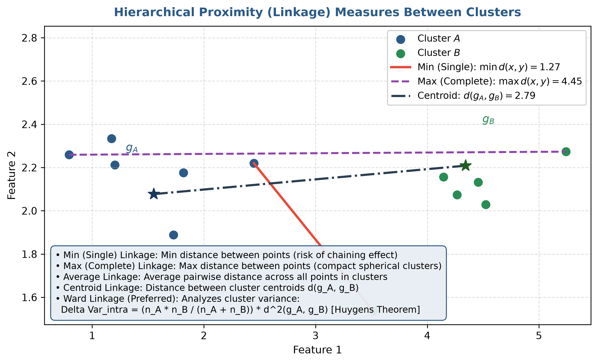

# Lecture 3: Data Exploration — Clustering

**Course:** Deep Learning (S.-A. Berrani, ENSIA 2026–2027)  
**Topic:** Clustering (Unsupervised Classification)

---

## Core Idea & Notation

**Clustering** is an **unsupervised classification** method whose objective is to **automatically partition a dataset using a similarity measure / distance**.

* **Input:**
  * A set of $N$ vectors describing $N$ individuals (also called samples, observations).
  * A set of parameters (related to the specific clustering algorithm).
* **Output:**
  * $k$ clusters.
  * $+$ noise (possibly).

### Why Cluster? Applications
1. **Summarize large datasets:**
   * A dataset contains individuals described using $d$ variables (features).
   * **Objective:** Put together similar individuals.
   * Instead of studying all of the individuals, we simply **study the characteristics of the group** rather than studying each of the individuals who compose it, or **study the average individual (centroid) in each group**.
2. **Image segmentation:**
   * *Input:* Pixels of an image (color/gray values, spatial position).
   * *Output:* Groups of similar and connected pixels. A homogeneous region is a cluster of pixels.
3. **Bioinformatics:** Grouping animals according to biological features to reconstruct phylogeny trees.
4. **Business:** Dividing customers into segments or forming a hierarchy of employees based on salary.
5. **Image processing:** Grouping handwritten characters in text recognition based on shape similarity.
6. **Information retrieval:** Categorizing search results based on the query.

### The 4 Practical Steps in Clustering
1. **Description of the individuals:** Feature extraction of individuals, followed by feature selection with respect to the application.
2. **Definition of a similarity measure between individuals:** Choosing an appropriate distance metric (e.g. Euclidean distance).
3. **Grouping individuals:** Executing the clustering algorithm using feature vectors and the associated similarity measure.
4. **Making use of clusters:** Interpretation, abstraction, profiling, and downstream modeling.

### Mathematical Notation
* $n$ (or $N$) --- total number of individuals ($v \in \mathbb{R}^d$).
* $d$ --- dimensionality (number of features / variables).
* $k$ --- number of clusters ($C_1, C_2, \dots, C_k$).
* $n_j$ --- number of individuals in cluster $j$, where $\sum_{j=1}^k n_j = n$.
* $v_i$ --- feature vector representing individual $i$.
* $g_j$ --- centroid (center of mass) of cluster $j$:
  $$g_j = \frac{1}{n_j} \sum_{v \in C_j} v$$
* $g$ --- centroid of the entire dataset (global center of mass):
  $$g = \frac{1}{n} \sum_{i=1}^n v_i = \sum_{j=1}^k \frac{n_j}{n} g_j$$
* $d(x, y)$ --- distance between two vectors (typically Euclidean distance $\|x - y\|$).

---

## 1. Quality Criteria: Intra-Cluster vs. Inter-Cluster Variance

  

To assess the quality of a clustering without ground-truth labels, we evaluate two geometric criteria:

### 1.1 Intra-Cluster Variance (Spread of each cluster)
Measures how tightly packed the individuals are around their respective cluster centroid:

$$\text{Intra cluster variance} = \frac{1}{n} \sum_{j=1}^k \sum_{i=1}^{n_j} d^2(v_i, g_j)$$

* **Goal:** **Minimize intra-cluster variance**.
* **Meaning:** Clusters must be **tightened on themselves** (low internal dispersion, high homogeneity).

### 1.2 Inter-Cluster Variance (Spacing of clusters from each other)
If we consider only the cluster centroids, we study the spread of centroids around the global centroid $g$:

$$\text{Inter cluster variance} = \sum_{j=1}^k \frac{n_j}{n} d^2(g, g_j)$$

* **Goal:** **Maximize inter-cluster variance**.
* **Meaning:** Clusters must be **far from each other** (high cluster separation).

---

### 1.3 Total Variance & Huygens' Theorem (Why the Two Goals are Identical)

The **total variance** of the dataset is the mean squared distance of all individuals to the global centroid $g$:

$$\text{Total variance} = \frac{1}{n} \sum_{i=1}^n d^2(v_i, g)$$

> **Theorem of Huygens:**
> $$\mathbf{\text{Total variance} = \text{Intra-cluster variance} + \text{Inter-cluster variance}}$$
> $$\mathbf{\text{Var}_{\text{total}} = \text{Var}_{\text{intra}} + \text{Var}_{\text{inter}} = \text{Constant}}$$

#### Mathematical Derivation / Proof:
For any individual $v_i$ assigned to cluster $C_j$, decompose its deviation from the dataset mean $g$:
$$(v_i - g) = (v_i - g_j) + (g_j - g)$$

Taking the squared Euclidean norm $\|v_i - g\|^2 = d^2(v_i, g)$:
$$\|v_i - g\|^2 = \|(v_i - g_j) + (g_j - g)\|^2 = \|v_i - g_j\|^2 + \|g_j - g\|^2 + 2\langle v_i - g_j, \, g_j - g\rangle$$

Summing over all $n_j$ individuals in cluster $C_j$:
$$\sum_{i=1}^{n_j} \|v_i - g\|^2 = \sum_{i=1}^{n_j} \|v_i - g_j\|^2 + \sum_{i=1}^{n_j} \|g_j - g\|^2 + 2\left\langle \sum_{i=1}^{n_j} (v_i - g_j), \; g_j - g \right\rangle$$

By definition of the centroid $g_j = \frac{1}{n_j}\sum_{i=1}^{n_j} v_i$, the sum of deviations around the cluster centroid is zero:
$$\sum_{i=1}^{n_j} (v_i - g_j) = \sum_{i=1}^{n_j} v_i - n_j g_j = n_j g_j - n_j g_j = \mathbf{0}$$

Therefore, the cross-term vanishes: $2\langle \mathbf{0}, g_j - g \rangle = 0$. Since $\|g_j - g\|^2$ does not depend on individual $i$, $\sum_{i=1}^{n_j} \|g_j - g\|^2 = n_j \|g_j - g\|^2$.

Summing across all $k$ clusters ($j=1, \dots, k$) and dividing by total count $n$:
$$\frac{1}{n}\sum_{j=1}^k\sum_{i=1}^{n_j} \|v_i - g\|^2 = \frac{1}{n}\sum_{j=1}^k\sum_{i=1}^{n_j} \|v_i - g_j\|^2 + \sum_{j=1}^k \frac{n_j}{n} \|g_j - g\|^2$$

$$\underbrace{\frac{1}{n}\sum_{i=1}^n d^2(v_i, g)}_{\text{Total variance}} = \underbrace{\frac{1}{n}\sum_{j=1}^k\sum_{i=1}^{n_j} d^2(v_i, g_j)}_{\text{Intra-cluster variance}} + \underbrace{\sum_{j=1}^k \frac{n_j}{n} d^2(g, g_j)}_{\text{Inter-cluster variance}}$$

#### Why Minimizing Intra $\equiv$ Maximizing Inter:
1. **The total variance is constant:** It depends purely on the fixed coordinates of the original data points $\{v_i\}$ and their global mean $g$. It is completely invariant to how points are partitioned into clusters: $\text{Var}_{\text{total}} = C$.
2. Rewriting:
   $$\text{Var}_{\text{inter}} = C - \text{Var}_{\text{intra}}$$
3. Therefore:
   $$\min \; \text{Var}_{\text{intra}} \iff \max \; (C - \text{Var}_{\text{intra}}) \iff \max \; \text{Var}_{\text{inter}}$$
4. **Conclusion:** Minimizing intra-cluster variance automatically and mathematically maximizes inter-cluster variance. **All you have to do is to optimize one of the two criteria.**

---

## 2. Overview of Existing Techniques

The course groups existing clustering techniques into 4 general families:

| Family | Definition / Mechanism | Algorithms Listed |
| :--- | :--- | :--- |
| **1. Data partitioning** | Iterative algorithms that refine an initial clustering. | **K-means**, CLARANS, Kohonen maps |
| **2. Hierarchical** | Hierarchical partitioning of the data into nested clusters. | **Traditional methods** (Agglomerative, Divisive), BIRCH |
| **3. Density-based** | Based on density estimation methods (parametric and non-parametric). | DBSCAN, DENCLUE |
| **4. Space partitioning** | Space quantization into multi-dimensional grid cells. | STING, Wave Cluster, Opti-Grid |

*(Note: The algorithms presented and explained in depth in the course are **K-Means** and **Hierarchical Clustering**).*

---

## 3. K-Means: The Algorithm

K-Means performs **"clustering around moving centers"**.

### Inputs
* $N$ individuals.
* $k$ centers (randomly chosen at the beginning).
* $k$ empty clusters.

### Detailed Step-by-Step Algorithm
**Repeat:**
1. **Assignment Step:** Distribute the $N$ individuals over the $k$ clusters using the rule of **"the nearest center"**:
   $$C_j = \big\{ v_i : d(v_i, g_j) \le d(v_i, g_l) \quad \forall l \in \{1, \dots, k\} \big\}$$
2. **Update Step:** Compute the new $k$ centers as the mean of each cluster:
   $$g_j = \frac{1}{n_j} \sum_{v \in C_j} v$$
**Until** two consecutive "clusterings" are identical (or centers stop moving).

### Properties of K-Means
* **Parameters:** Requires setting the number of clusters $k$ beforehand.
* **Non-deterministic:** Sensitive to initial conditions (different initial random centers can lead to different local minima).
* **Iterative:** Requires several passes over the dataset.
* **Complexity:** $O(N)$ (linear in the number of individuals).

---

## 4. Hierarchical Clustering

### 4.1 Visual Representation: The Dendrogram & Cutting Level
* **Visual representation:** Clusters are visually represented in a hierarchical tree called a **dendrogram**.
* **No need to pre-specify $k$:** There is no need to pre-specify the number of clusters. Instead, the dendrogram can be cut horizontally at the appropriate level to obtain the desired number of clusters.
* **Summarization & Interpretation:** Data is easily organized and summarized into a hierarchy using dendrograms; dendrograms make it easy to examine and interpret clusters.
* **Requires a proximity measure** between clusters.
* **Handling Large Datasets:** If we have a very large dataset, the bottom of the dendrogram may be unreadable due to overcrowding of individual leaves $\implies$ **Solution: Show and focus on the top part of the tree.**

  

---

### 4.2 The Two Main Types: Agglomerative vs. Divisive
1. **Agglomerative (Bottom-Up):**
   * Initially, each object is considered to be its own cluster ($N$ singleton clusters).
   * According to a particular procedure, the clusters are then merged step by step until a single cluster remains containing all elements.
2. **Divisive (Top-Down):**
   * Initially, all objects are considered in a single cluster.
   * Then the division process is performed step by step until each object forms a different cluster.

  

---

### 4.3 Proximity / Similarity Measures Between Clusters (Linkage Criteria)

To decide which two clusters to merge at each step, a linkage/proximity measure between clusters $C_A$ and $C_B$ must be defined:

1. **Min (Single) Linkage:**
   * The distance between 2 clusters is the **minimum distance** between points in those clusters:
     $$d(C_A, C_B) = \min_{x \in C_A, y \in C_B} d(x, y)$$
2. **Max (Complete) Linkage:**
   * The distance between 2 clusters is the **maximum distance** between points in those clusters:
     $$d(C_A, C_B) = \max_{x \in C_A, y \in C_B} d(x, y)$$
3. **Average Linkage:**
   * The distance between 2 clusters is the **average pairwise distance** among all pairs of points in the clusters:
     $$d(C_A, C_B) = \frac{1}{|C_A| |C_B|} \sum_{x \in C_A} \sum_{y \in C_B} d(x, y)$$
4. **Centroid Linkage:**
   * The distance between 2 clusters is the **distance between their centroids**:
     $$d(C_A, C_B) = d(g_A, g_B)$$
5. **Ward Linkage (Preferred Approach):**
   * The Ward approach **analyzes the variance of the clusters** rather than measuring distances directly, minimizing the variance between clusters.
   * It consists of grouping clusters so that the **increase in inter-cluster variance is maximum**.
   * This amounts to the exact same thing according to **Huygens' theorem**: **The increase in intra-class inertia is minimum**:
     $$\Delta \text{Var}_{\text{intra}}(C_A, C_B) = \frac{n_A n_B}{n_A + n_B} d^2(g_A, g_B)$$
   * **Ward's method is preferred more than others in clustering.**

  

---

### 4.4 Properties of Hierarchical Clustering
* Unlike K-means, hierarchical classification **does not require choosing a number of clusters beforehand**.
* **Deterministic:** Algorithm is **independent of the order of insertion of points**.
* **Complexity:** $O(n^3)$ (or $O(n^2)$ optimized).

---

## 5. Worked Toy Example: K-Means Iteration & Ward Linkage

**Setup:** 4 individuals in 2D space:
* $v_1 = (1, 1)$, $v_2 = (2, 1)$, $v_3 = (4, 3)$, $v_4 = (5, 4)$.
* **Global Centroid:**
  $$g = \frac{1}{4} \big( (1,1) + (2,1) + (4,3) + (5,4) \big) = (3.0, \, 2.25)$$
* **Initial K-Means Seeds:** $k = 2$ centers: $g_1^{(0)} = (1, 1)$, $g_2^{(0)} = (5, 4)$.

### 5.1 One K-Means Iteration
1. **Assignment (Nearest Center):**
   * $d^2(v_1, g_1) = 0 < 25 \implies v_1 \in C_1$
   * $d^2(v_2, g_1) = 1 < 18 \implies v_2 \in C_1$
   * $d^2(v_3, g_1) = 13 > 2 \implies v_3 \in C_2$
   * $d^2(v_4, g_1) = 25 > 0 \implies v_4 \in C_2$
   * **Clusters formed:** $C_1 = \{v_1, v_2\}$ ($n_1 = 2$), $C_2 = \{v_3, v_4\}$ ($n_2 = 2$).
2. **Centroid Update:**
   $$g_1^{(1)} = \frac{(1, 1) + (2, 1)}{2} = (1.5, \, 1.0)$$
   $$g_2^{(1)} = \frac{(4, 3) + (5, 4)}{2} = (4.5, \, 3.5)$$

### 5.2 Quality Criteria & Huygens Verification
1. **Intra-Cluster Variance ($\text{Var}_{\text{intra}}$):**
   $$\text{Var}_{\text{intra}} = \frac{1}{4} \big( \|v_1-g_1\|^2 + \|v_2-g_1\|^2 + \|v_3-g_2\|^2 + \|v_4-g_2\|^2 \big)$$
   $$\text{Var}_{\text{intra}} = \frac{1}{4} \big( 0.25 + 0.25 + 0.50 + 0.50 \big) = \mathbf{0.375}$$
2. **Inter-Cluster Variance ($\text{Var}_{\text{inter}}$):**
   $$\text{Var}_{\text{inter}} = \frac{2}{4} d^2(g, g_1) + \frac{2}{4} d^2(g, g_2) = \frac{1}{2}(3.8125) + \frac{1}{2}(3.8125) = \mathbf{3.8125}$$
3. **Total Variance Check (Huygens' Theorem):**
   $$\text{Var}_{\text{total}} = \text{Var}_{\text{intra}} + \text{Var}_{\text{inter}} = 0.375 + 3.8125 = \mathbf{4.1875}$$
   *Direct calculation from dataset center:*
   $$\frac{1}{4}\sum_{i=1}^4 d^2(v_i, g) = \frac{1}{4} (5.5625 + 2.5625 + 1.5625 + 7.0625) = \mathbf{4.1875}$$
   *Identity verified!*

### 5.3 Ward Linkage Calculation
If merging clusters $C_1$ and $C_2$ hierarchically:
$$\Delta \text{Var}_{\text{intra}}(C_1, C_2) = \frac{n_1 n_2}{n_1 + n_2} d^2(g_1, g_2) = \frac{2 \times 2}{2 + 2} \big( (1.5 - 4.5)^2 + (1.0 - 3.5)^2 \big) = 1 \cdot (9 + 6.25) = \mathbf{15.25}$$

---

## 6. Summary Comparison: K-Means vs. Hierarchical

| Feature | K-Means | Hierarchical Clustering |
| :--- | :--- | :--- |
| **Number of clusters $k$** | Must be chosen beforehand | Not required beforehand (cut dendrogram at chosen level) |
| **Determinism** | Non-deterministic (sensitive to initial seeds) | **Deterministic** (independent of point insertion order) |
| **Output structure** | Flat partition | Hierarchical tree (**dendrogram**) |
| **Time complexity** | **$O(N)$** (linear in data size) | **$O(n^3)$** (higher computational cost) |
| **Large datasets** | Scales well | Bottom of dendrogram unreadable $\implies$ focus on top part |
| **Preferred linkage** | Nearest centroid | **Ward linkage** (variance-based, Huygens' theorem) |
