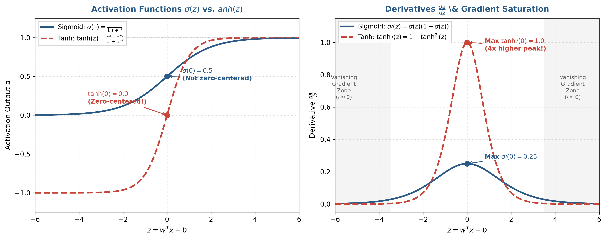
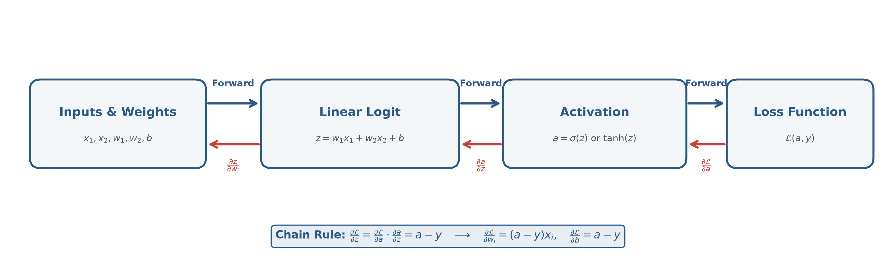

# Lecture 5: Deep Learning — Logistic Regression

**Course:** Deep Learning (S.-A. Berrani, ENSIA 2026–2027)  
**Topic:** Logistic Regression, Loss & Cost Functions, Activation Functions & Gradient Descent

---

## Core Idea & Notation

**Logistic Regression** is an algorithm for **binary classification** where the objective is to estimate the probability that a given input sample belongs to a target class (e.g., $y = 1$). Unlike linear regression, which outputs unbounded continuous values, logistic regression bounds its predictions to the interval $[0, 1]$ using a non-linear activation function.

### Mathematical Notation & Setup
* $n_x$ --- number of input features (e.g., unrolled image $32 \times 64 \times 3 = 6144$ pixels).
* $m$ --- number of training instances (samples).
* $x^{(i)} \in \mathbb{R}^{n_x}$ --- feature vector of the $i$-th training example.
* $y^{(i)} \in \{0, 1\}$ --- ground-truth binary label for the $i$-th example (e.g., $1 = \text{cat}$, $0 = \text{non-cat}$).
* $X \in \mathbb{R}^{n_x \times m}$ --- dataset design matrix containing all training vectors as columns:
  $$X = \begin{bmatrix} \vert & \vert & & \vert \\ x^{(1)} & x^{(2)} & \cdots & x^{(m)} \\ \vert & \vert & & \vert \end{bmatrix}$$
* $Y \in \mathbb{R}^{1 \times m}$ --- row vector containing all corresponding ground-truth labels:
  $$Y = \begin{bmatrix} y^{(1)} & y^{(2)} & \cdots & y^{(m)} \end{bmatrix}$$
* $w \in \mathbb{R}^{n_x}$ --- weight vector (trainable parameters).
* $b \in \mathbb{R}$ --- bias term (trainable scalar).
* $\hat{y} \in [0, 1]$ (often denoted as $a$) --- predicted output probability: $\hat{y} = a = P(y = 1 \mid x)$.

---

## 1. Defining $\hat{y}$ in Terms of Probability and $w^T x + b$

In binary classification, given an input feature vector $x \in \mathbb{R}^{n_x}$, our objective is to predict the conditional probability:

$$\hat{y} = P(y = 1 \mid x) \in [0, 1] \qquad \implies \qquad P(y = 0 \mid x) = 1 - P(y = 1 \mid x) = 1 - \hat{y}$$

### Why a Raw Linear Function is Insufficient
If we simply used a linear combination of inputs:

$$z = w^T x + b = \sum_{j=1}^{n_x} w_j x_j + b$$

the scalar $z$ could take any value in $(-\infty, +\infty)$. A linear function can easily predict values less than 0 or greater than 1, violating fundamental probability axioms.

### The Sigmoid Squashing Function
To transform the unbounded real number $z \in (-\infty, +\infty)$ into a valid probability $\hat{y} \in (0, 1)$, we apply the **sigmoid activation function** $\sigma(z)$:

$$\hat{y} = a = \sigma(z) = \sigma(w^T x + b) = \frac{1}{1 + e^{-(w^T x + b)}}$$

#### Limiting Behaviors:
* **Large positive $z$ ($z \to +\infty$):** $e^{-z} \to 0 \implies \sigma(z) \to \frac{1}{1 + 0} = \mathbf{1}$ (high confidence in positive class).
* **Large negative $z$ ($z \to -\infty$):** $e^{-z} \to +\infty \implies \sigma(z) \to \frac{1}{1 + \infty} = \mathbf{0}$ (high confidence in negative class).
* **Zero score ($z = 0$):** $\sigma(0) = \frac{1}{1 + 1} = \mathbf{0.5}$ $\implies$ Defines the **decision boundary** hyperplane $w^T x + b = 0$.

---

## 2. Loss Functions: Squared Error vs. Binary Cross-Entropy

> **Definition (Loss Function):** A loss function $\mathcal{L}(\hat{y}, y)$ measures the error / discrepancy between the model's prediction $\hat{y}$ and the ground-truth target $y$ on a **single training instance** $(x, y)$.

### 2.1 Squared Error Loss
$$\mathcal{L}_{\text{SE}}(\hat{y}, y) = \frac{1}{2}(\hat{y} - y)^2$$

While standard in linear regression, Squared Error is **poorly suited for logistic regression**:
1. **Non-Convex Optimization Surface:** Because $\hat{y} = \sigma(w^T x + b)$ is non-linear, substituting it into squared error creates a non-convex landscape with numerous local minima and flat saddle regions where gradient descent can easily get trapped.
2. **Vanishing Gradient on Bad Predictions:** The derivative with respect to $z$ is:
   $$\frac{\partial \mathcal{L}_{\text{SE}}}{\partial z} = (\hat{y} - y) \cdot \sigma'(z) = (\hat{y} - y) \, \hat{y}(1 - \hat{y})$$
   When the prediction is completely wrong (e.g., $y = 1$ but $\hat{y} \approx 0$), the term $\hat{y}(1 - \hat{y}) \approx 0$, causing the gradient to vanish. The model learns slowest precisely when it is making its worst errors.

### 2.2 Binary Cross-Entropy Loss (Log Loss)
$$\mathcal{L}_{\text{BCE}}(\hat{y}, y) = - \big[ y \log \hat{y} + (1 - y) \log(1 - \hat{y}) \big]$$

#### Intuitive Mechanics:
* **If $y = 1$:** $\mathcal{L} = -\log(\hat{y})$. As $\hat{y} \to 1$, $\mathcal{L} \to 0$. As $\hat{y} \to 0$, $\mathcal{L} \to +\infty$ (infinite penalty).
* **If $y = 0$:** $\mathcal{L} = -\log(1 - \hat{y})$. As $\hat{y} \to 0$, $\mathcal{L} \to 0$. As $\hat{y} \to 1$, $\mathcal{L} \to +\infty$ (infinite penalty).

**Key Benefit:** Binary cross-entropy cancels the $\hat{y}(1 - \hat{y})$ factor during backpropagation, yielding $\frac{\partial \mathcal{L}}{\partial z} = \hat{y} - y$. This guarantees a **strictly convex optimization problem** with a single global minimum and large gradients when errors are large.

---

### 2.3 Brief Note: Derivation from Maximum Likelihood Estimation (MLE)
Both loss functions naturally emerge as the negative log-likelihood of specific probabilistic noise models:

* **Squared Error from MLE:** Assumes continuous targets corrupted by additive Gaussian noise $\epsilon \sim \mathcal{N}(0, \sigma^2)$, such that $P(y \mid x) = \frac{1}{\sqrt{2\pi\sigma^2}} \exp\left(-\frac{(y - \hat{y})^2}{2\sigma^2}\right)$. Maximizing likelihood $\iff$ minimizing negative log-likelihood $\sum \frac{(y - \hat{y})^2}{2\sigma^2} \propto \frac{1}{2}\sum (\hat{y} - y)^2$.
* **Binary Cross-Entropy from MLE:** Assumes binary labels drawn from a **Bernoulli distribution** with success probability $P(y = 1 \mid x) = \hat{y}$. The probability mass function is written compactly as:
  $$P(y \mid x) = \hat{y}^y \, (1 - \hat{y})^{1-y}$$
  Taking the negative natural logarithm gives the exact cross-entropy loss:
  $$-\log P(y \mid x) = - \big[ y \log \hat{y} + (1 - y) \log(1 - \hat{y}) \big]$$
  Maximizing the total dataset likelihood $\prod_{i=1}^m P(y^{(i)} \mid x^{(i)})$ is identical to minimizing the sum of cross-entropy losses.

---

## 3. Cost Function: Overall Training Objective

> **Definition (Cost Function):** The cost function $J(w, b)$ evaluates the overall performance of the model over the **entire training dataset of $m$ examples**. It is the arithmetic mean of the individual sample losses:
> $$J(w, b) = \frac{1}{m} \sum_{i=1}^m \mathcal{L}\big(\hat{y}^{(i)}, y^{(i)}\big)$$

### 3.1 Cost Function with Cross-Entropy (Logistic Regression)
$$J(w, b) = -\frac{1}{m} \sum_{i=1}^m \Big[ y^{(i)} \log \hat{y}^{(i)} + (1 - y^{(i)}) \log\big(1 - \hat{y}^{(i)}\big) \Big]$$
where $\hat{y}^{(i)} = \sigma(w^T x^{(i)} + b)$. This cost function is convex with respect to $w$ and $b$, guaranteeing global convergence.

### 3.2 Cost Function with Mean Squared Error (MSE — Linear Regression)
$$J(w) = \frac{1}{2m} \sum_{i=1}^m \big(w^T x^{(i)} - y^{(i)}\big)^2 = \frac{1}{2m} \|X^T w - Y\|_2^2$$

#### Analytical Solution vs. Gradient Descent (Slide 17):
In linear regression with MSE, setting $\nabla_w J = 0$ yields the exact closed-form solution:
$$w^* = (X X^T)^{-1} X Y^T \quad \text{or} \quad (X^T X)^{-1} X^T Y$$
* **The Limitation:** Solving this requires inverting a matrix of dimension $n_x \times n_x$ (complexity $\mathcal{O}(n_x^3)$).
* **When $n_x$ is large** (e.g., in deep learning where $n_x = 6144$ or millions), matrix inversion is computationally prohibitive or impossible if singular. Hence, iterative **gradient descent** is required.

---

## 4. Activation Functions: Sigmoid vs. Tanh

<p align="center">
  
</p>

### 4.1 Sigmoid Function
* **Formula:**
  $$\sigma(z) = \frac{1}{1 + e^{-z}}$$
* **Range:** $(0, 1)$
* **Center:** $\sigma(0) = 0.5$ (**not zero-centered**).
* **Derivative:**
  $$\sigma'(z) = \frac{d\sigma(z)}{dz} = \sigma(z)\big(1 - \sigma(z)\big)$$
  * *Peak derivative:* $\sigma'(0) = 0.5 \times 0.5 = \mathbf{0.25}$.
* **Key Properties:**
  * Maps real values to probabilities.
  * **Drawback 1 (Vanishing Gradient):** For $|z| > 4$, the curve saturates and $\sigma'(z) \approx 0$, stopping weight updates during backpropagation.
  * **Drawback 2 (Non-zero centered):** Since output $\sigma(z) > 0$ always, the gradients on weights in a subsequent layer will all have the same sign (all positive or all negative), inducing zigzagging dynamics during gradient descent.

### 4.2 Hyperbolic Tangent (Tanh) Function
* **Formula:**
  $$\tanh(z) = \frac{e^z - e^{-z}}{e^z + e^{-z}} = \frac{1 - e^{-2z}}{1 + e^{-2z}} = 2\sigma(2z) - 1$$
* **Range:** $(-1, 1)$
* **Center:** $\tanh(0) = 0$ (**strictly zero-centered!**).
* **Derivative:**
  $$\tanh'(z) = \frac{d\tanh(z)}{dz} = 1 - \tanh^2(z)$$
  * *Peak derivative:* $\tanh'(0) = 1 - 0 = \mathbf{1.0}$ ($4\times$ larger peak slope than sigmoid!).
* **Key Properties:**
  * **Zero-centered:** Mean output is close to 0, which centers activations and speeds up gradient descent convergence in multi-layer networks.
  * Steeper gradients around 0 reduce the flat plateau effect compared to sigmoid.
  * Still suffers from the vanishing gradient problem when $|z| > 3$ due to asymptotic saturation at $\pm 1$.

### Summary Comparison Table

| Property | Sigmoid $\sigma(z)$ | Hyperbolic Tangent $\tanh(z)$ |
| :--- | :--- | :--- |
| **Formula** | $\frac{1}{1 + e^{-z}}$ | $\frac{e^z - e^{-z}}{e^z + e^{-z}}$ |
| **Output Range** | $(0, 1)$ | $(-1, 1)$ |
| **Zero-Centered?** | No ($\sigma(0) = 0.5$) | **Yes** ($\tanh(0) = 0$) |
| **Derivative Formula** | $\sigma(z)\big(1 - \sigma(z)\big)$ | $1 - \tanh^2(z)$ |
| **Maximum Derivative** | $0.25$ (at $z = 0$) | **$1.0$** (at $z = 0$) |
| **Saturation / Flat Tails** | For $|z| > 4 \implies \sigma' \approx 0$ | For $|z| > 3 \implies \tanh' \approx 0$ |
| **Primary DL Usage** | Output layer for binary classification | Hidden layers (superseded by ReLU in deep nets) |

---

## 5. Fitting the Model & Gradient Descent

### 5.1 What Does "Fitting the Model" Mean?
"Fitting" (or training) the model means tuning the internal parameters ($w \in \mathbb{R}^{n_x}$ and $b \in \mathbb{R}$) using the labeled training examples such that the cost function $J(w, b)$ is minimized:

$$(w^*, b^*) = \arg\min_{w, b} J(w, b)$$

Geometrically, fitting adjusts the orientation ($w$) and displacement ($b$) of the decision boundary hyperplane $w^T x + b = 0$ so that positive instances ($y = 1$) lie on the positive side ($\hat{y} > 0.5$) and negative instances ($y = 0$) lie on the negative side ($\hat{y} < 0.5$) with highest possible confidence.

### 5.2 Gradient Descent Optimization
Because an analytical inversion is unavailable or intractable, parameters are updated iteratively by taking steps in the direction of steepest descent (the negative gradient $-\nabla J$):

$$\text{Repeat until convergence:} \quad \begin{cases} w := w - \alpha \dfrac{\partial J(w, b)}{\partial w} \\[8pt] b := b - \alpha \dfrac{\partial J(w, b)}{\partial b} \end{cases}$$

where $\alpha > 0$ is the **learning rate** (hyperparameter):
* If $\alpha$ is too small: convergence is excessively slow.
* If $\alpha$ is too large: updates oscillate or diverge completely.

<p align="center">
  
</p>

---

## 6. Batch Gradient Descent Algorithm on $m$ Examples & Vectorization (Slide 25)

When training over all $m$ examples simultaneously, the parameter gradients are the average of individual sample gradients:

### Loop Implementation
```python
# Initialize gradients and cost
J = 0
dw1 = 0
dw2 = 0
db = 0

# Accumulate over m examples
for i in range(1, m + 1):
    # Forward pass
    z_i = w1 * x1[i] + w2 * x2[i] + b
    a_i = sigmoid(z_i)
    J += - (y[i] * log(a_i) + (1 - y[i]) * log(1 - a_i))
    
    # Backward pass
    dz_i = a_i - y[i]
    dw1 += x1[i] * dz_i
    dw2 += x2[i] * dz_i
    db  += dz_i

# Average across m examples
J   /= m
dw1 /= m
dw2 /= m
db  /= m

# Parameter updates
w1 = w1 - alpha * dw1
w2 = w2 - alpha * dw2
b  = b  - alpha * db
```

### Vectorized Matrix Formulation (Fast Execution)
In modern deep learning frameworks, explicit `for` loops are avoided in favor of matrix broadcasting:

1. **Forward Pass:**
   $$Z = w^T X + b \in \mathbb{R}^{1 \times m}, \qquad A = \sigma(Z) \in \mathbb{R}^{1 \times m}$$
   $$J = -\frac{1}{m} \big[ Y \log(A)^T + (1 - Y) \log(1 - A)^T \big]$$

2. **Backward Pass:**
   $$dZ = A - Y \in \mathbb{R}^{1 \times m}$$
   $$dw = \frac{1}{m} X \, dZ^T \in \mathbb{R}^{n_x \times 1}, \qquad db = \frac{1}{m} \sum_{i=1}^m dZ^{(i)} \in \mathbb{R}$$

3. **Parameter Updates:**
   $$w := w - \alpha \, dw, \qquad b := b - \alpha \, db$$

---

## 7. Side-by-Side Example Derivation: $z = w_1 x_1 + w_2 x_2 + b$

Consider a model with 2 input features ($x_1, x_2$), two weights ($w_1, w_2$), and bias $b$. Below is the step-by-step mathematical comparison of Forward and Backward propagation for:
1. **Left:** Sigmoid with Standard Binary Cross-Entropy ($y \in \{0, 1\}$)
2. **Right:** Tanh with Modified Cross-Entropy ($y \in \{-1, +1\}$) *(Slides 26–27)*

---

### Step 1: Forward Propagation

| Step | Sigmoid + Standard Cross-Entropy | Tanh + Modified Cross-Entropy |
| :--- | :--- | :--- |
| **Label space** | $y \in \{0, 1\}$ | $y \in \{-1, +1\}$ |
| **Linear score** | $z = w_1 x_1 + w_2 x_2 + b$ | $z = w_1 x_1 + w_2 x_2 + b$ |
| **Activation** | $a = \sigma(z) = \dfrac{1}{1 + e^{-z}} \in (0, 1)$ | $a = \tanh(z) = \dfrac{e^z - e^{-z}}{e^z + e^{-z}} \in (-1, 1)$ |
| **Class probabilities** | $P(y=1\mid x) = a$<br>$P(y=0\mid x) = 1 - a$ | $P(y=1\mid x) = \dfrac{1 + a}{2}$<br>$P(y=-1\mid x) = \dfrac{1 - a}{2}$ |
| **Loss Function $\mathcal{L}(a, y)$** | $\mathcal{L} = -\big[ y \log a + (1 - y) \log(1 - a) \big]$ | $\mathcal{L} = -\left[ \dfrac{1 + y}{2} \log\left(\dfrac{1 + a}{2}\right) + \dfrac{1 - y}{2} \log\left(\dfrac{1 - a}{2}\right) \right]$ |

---

### Step 2: Backward Propagation (Step-by-Step Chain Rule)

#### Step 2.1: $\dfrac{\partial \mathcal{L}}{\partial a}$ (Derivative of Loss w.r.t Activation)

* **Sigmoid Path:**
  $$\frac{\partial \mathcal{L}}{\partial a} = -\frac{y}{a} + \frac{1 - y}{1 - a} = \frac{-y(1 - a) + a(1 - y)}{a(1 - a)} = \frac{a - y}{a(1 - a)}$$

* **Tanh Path:**
  Let $u = \frac{1+a}{2} \implies \frac{du}{da} = \frac{1}{2}$ and $v = \frac{1-a}{2} \implies \frac{dv}{da} = -\frac{1}{2}$:
  $$\frac{\partial \mathcal{L}}{\partial a} = -\frac{1 + y}{2} \cdot \frac{1}{\frac{1 + a}{2}} \cdot \frac{1}{2} - \frac{1 - y}{2} \cdot \frac{1}{\frac{1 - a}{2}} \cdot \left(-\frac{1}{2}\right) = -\frac{1 + y}{2(1 + a)} + \frac{1 - y}{2(1 - a)}$$
  Putting both terms over common denominator $2(1 - a^2)$:
  $$\frac{\partial \mathcal{L}}{\partial a} = \frac{-(1 + y)(1 - a) + (1 - y)(1 + a)}{2(1 - a^2)} = \frac{-(1 - a + y - ya) + (1 + a - y - ya)}{2(1 - a^2)} = \frac{2a - 2y}{2(1 - a^2)} = \mathbf{\frac{a - y}{1 - a^2}}$$

---

#### Step 2.2: $\dfrac{\partial a}{\partial z}$ (Derivative of Activation w.r.t $z$)

* **Sigmoid Path:**
  $$\frac{\partial a}{\partial z} = \sigma'(z) = \frac{\partial}{\partial z}\left(\frac{1}{1 + e^{-z}}\right) = \frac{e^{-z}}{(1 + e^{-z})^2} = \left(\frac{1}{1 + e^{-z}}\right)\left(1 - \frac{1}{1 + e^{-z}}\right) = \mathbf{a(1 - a)}$$

* **Tanh Path:**
  $$\frac{\partial a}{\partial z} = \tanh'(z) = \frac{d}{dz}\left(\frac{\sinh z}{\cosh z}\right) = \frac{\cosh^2 z - \sinh^2 z}{\cosh^2 z} = 1 - \tanh^2(z) = \mathbf{1 - a^2}$$

---

#### Step 2.3: $\dfrac{\partial \mathcal{L}}{\partial z} = \dfrac{\partial \mathcal{L}}{\partial a} \cdot \dfrac{\partial a}{\partial z}$ (The Critical Cancellation!)

* **Sigmoid Path:**
  $$\frac{\partial \mathcal{L}}{\partial z} = \left(\frac{a - y}{a(1 - a)}\right) \cdot a(1 - a) = \mathbf{a - y}$$

* **Tanh Path:**
  $$\frac{\partial \mathcal{L}}{\partial z} = \left(\frac{a - y}{1 - a^2}\right) \cdot (1 - a^2) = \mathbf{a - y}$$

> **Key Insight:** In **both** cases, the derivative of the activation function cancels out against the denominator of the loss gradient! This remarkable property means $\frac{\partial \mathcal{L}}{\partial z} = a - y$ in both frameworks, ensuring error-proportional gradient flow.

---

#### Step 2.4: Gradients with Respect to Parameters ($w_1, w_2, b$)

Since $z = w_1 x_1 + w_2 x_2 + b$:
$$\frac{\partial z}{\partial w_1} = x_1, \qquad \frac{\partial z}{\partial w_2} = x_2, \qquad \frac{\partial z}{\partial b} = 1$$

Applying the chain rule $\frac{\partial \mathcal{L}}{\partial \theta} = \frac{\partial \mathcal{L}}{\partial z} \cdot \frac{\partial z}{\partial \theta}$ yields identical forms for both:

| Parameter | Partial Derivative $\dfrac{\partial \mathcal{L}}{\partial \theta}$ | Parameter Update ($\theta := \theta - \alpha \dfrac{\partial \mathcal{L}}{\partial \theta}$) |
| :--- | :--- | :--- |
| **Weight $w_1$** | $\dfrac{\partial \mathcal{L}}{\partial w_1} = (a - y) \, x_1$ | $w_1 := w_1 - \alpha (a - y) \, x_1$ |
| **Weight $w_2$** | $\dfrac{\partial \mathcal{L}}{\partial w_2} = (a - y) \, x_2$ | $w_2 := w_2 - \alpha (a - y) \, x_2$ |
| **Bias $b$** | $\dfrac{\partial \mathcal{L}}{\partial b} = a - y$ | $b := b - \alpha (a - y)$ |
