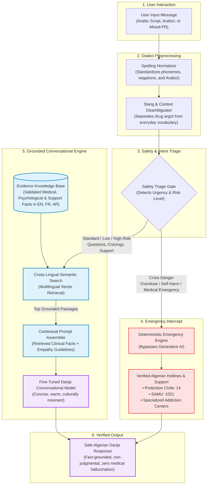
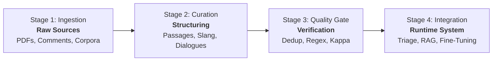

# Project 16: Algerian Darija Addiction Support System
## Master Architecture & Execution Plan

> **Project Mission**: Build an empathetic, culturally tailored conversational assistant in Algerian Darija (supporting Arabic script, Arabizi, and Franco-Arabe code-switching) to assist individuals and families dealing with substance misuse, combining verified health evidence with an immediate, deterministic crisis safety net.

---

## 1. High-Level System Architecture

The solution uses a **Dual-Engine Design** coupled with an upstream **Safety Triage Gate**:

---

## 2. The End-to-End Data Delivery Pipeline Explained

### The Core Concept: A Structured NLP Factory Line
Medical truth resides in formal **English and French PDFs** (WHO, Algerian ONLCDT). Target users speak informal **Algerian Darija, Arabizi, and street slang** (e.g., *Zatla, Karkoubi, Lyrica*). This pipeline connects both worlds cleanly without medical hallucination or translation corruption.

### The 4 Stages in Plain Language:

1. **Stage 1: Collect Raw Data (Ingestion)**
   * Gather two core ingredients: (1) official health reports from WHO and the Algerian Ministry of Health to establish verified medical truth, and (2) public YouTube and Reddit comments to observe how Algerians actually speak and use street slang.
2. **Stage 2: Slice and Structure (Curation)**
   * Cut 200-page PDFs into short, bite-sized **50–150 word notes** (kept in English, French, and Arabic).
   * Build the slang dictionary to handle words with double meanings (e.g. *chira* = cannabis vs. girlfriend).
   * Write 120 practice dialogues where every answer strictly cites a specific medical note.
3. **Stage 3: Check and Filter (Quality Gate)**
   * Run an automated script to erase any phone numbers or real names (privacy protection).
   * Use vector similarity to detect and delete duplicate medical advice.
   * Have two teammates label the same messages to verify that the labels are consistent and objective (Cohen's Kappa test).
4. **Stage 4: Power the System (Integration)**
   * Plug each clean dataset into its AI role: labeled comments train the **Emergency Triage Gate**, medical notes fill the **RAG Search Database**, and practice dialogues teach the language model to speak warm, natural Algerian Darija.

---

### Concrete Walkthrough: How One Medical Fact Travels Through the Pipeline

| Pipeline Step | Action Taken | Project 16 Concrete Implementation |
| :--- | :--- | :--- |
| **Stage 1: Ingestion** | Gather source document | Official WHO ASSIST Self-Help Guide downloaded (60-page PDF in English). |
| **Stage 2: Curation** | Slice into atomic passage | Extract 70-word snippet: *"Cravings typically peak within 15 to 30 minutes; drinking water and changing activities helps."* (Preserved in English). |
| **Stage 3: Quality Gate** | Screening & Deduplication | Automated script confirms formatting, verifies no duplicate exists in the French reports, and assigns unique ID. |
| **Stage 4: Integration** | Index into Knowledge Base | Snippet is vectorized and indexed into the multilingual semantic vector database. |
| **Live App Runtime** | User query in Darija | User asks: **"واش ندير كي تجيني رغبة قوية باش نكمي؟"** Retriever pulls English WHO passage; Model responds in warm Darija: **"الرغبة هادي ديما تفوت في 15 حتى لـ 30 دقيقة، جرب تبدل البلاصة، تشرب الما..."** |

---

## 3. Four Core Principles for the Whole Team

1. **Retain Passages in Original Languages (EN / FR / AR)**:
   * Do not machine-translate raw clinical guidelines into Darija beforehand. Machine translation creates severe medical hallucination and terminology risks.
   * The retrieval engine searches across languages semantically, and the model generates responses in natural Algerian Darija using the retrieved facts.
2. **Zero-Hallucination on Crisis Situations**:
   * Any message indicating overdose, loss of consciousness, or suicidal ideation completely bypasses the generative LLM.
   * The system immediately outputs certified, pre-approved emergency templates providing verified Algerian hotlines (`Protection Civile: 14`, `SAMU: 1021`, and specialized addiction centers).
3. **Religious Guidance is Strictly Opt-In**:
   * While spiritual encouragement can offer personal solace, introducing unsolicited religious advice in medical addiction contexts creates moral stigma and alienates vulnerable users.
   * Religious passages are cataloged as a specialized category and are **only surfaced if the user explicitly asks for them**.
4. **Fact-Grounded Conversational Integrity**:
   * Every assistant dialogue and conversational output must be grounded directly in verified clinical passages.
   * The assistant is strictly constrained to genuine health strategies and never invents medical advice, withdrawal timelines, or treatment protocols.
