# Wireless Communication Networks and Systems
## Lab 01 Report: Fundamentals of Signal Transmission
**Student:** BELHIMER Mohmaed Ayoub  
**Simulation:** Python (NumPy, Matplotlib)

---

## 1. Experimental Results & Answers to Questions

### Step 1 – Generate a Sine Wave
We generate a sine wave $s(t) = A \cdot \sin(2\pi f t)$ with $A = 1$, $f = 1000\text{ Hz}$, and $f_s = 10000\text{ Hz}$ over $5\text{ ms}$. We also test $500\text{ Hz}$ and $2000\text{ Hz}$.

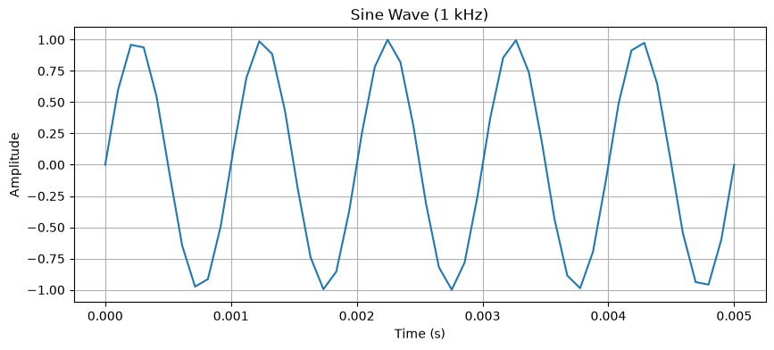

| Sine Wave at 500 Hz | Sine Wave at 2000 Hz |
| :---: | :---: |
| 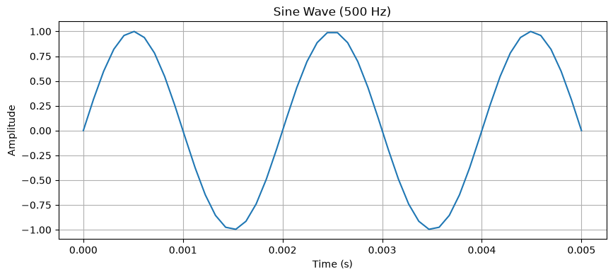 | 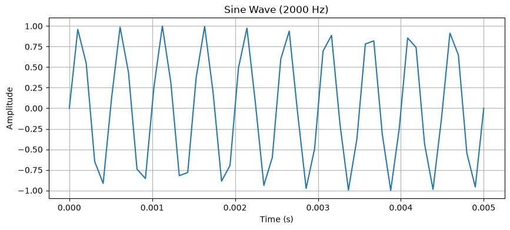 |

* **Task:** *Change the frequency to 500 Hz and 2000 Hz. What happens?*
* **Answer:** Lower frequency gives fewer cycles in the same time ($2.5$ cycles for $500\text{ Hz}$). Higher frequency gives more cycles ($10$ cycles for $2000\text{ Hz}$). In both cases, the amplitude stays the same at 1.

---

### Step 2 – Frequency Analysis (FFT)
We compute the FFT to see the signal's frequency components.

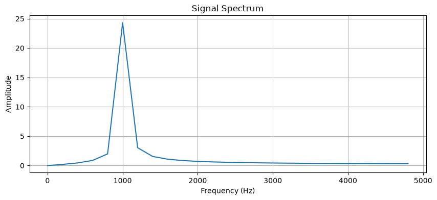

* **Question:** *Identify the dominant frequency in the spectrum.*
* **Answer:** The dominant frequency is $1\text{ kHz}$ ($1000\text{ Hz}$), which is where the main peak appears in the spectrum.

---

### Step 3 – Attenuation
We simulate attenuation by scaling the signal: `attenuated = 0.5 * signal`.

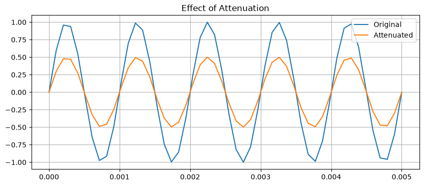

* **Question:** *Why is attenuation problematic for Wi-Fi?*
* **Answer:** Attenuation reduces the signal strength as it travels through the air and obstacles like walls. This makes the Wi-Fi signal harder for devices to detect, leading to connection drops, lower data speeds, and reduced coverage range.

---

### Step 4 – Add Noise
We add Gaussian noise with different values of $\sigma$ (0.1, 0.5, 1.0) and observe the signal in both time and frequency domains:

| Time Domain (Noisy Signal) | Frequency Domain (FFT Spectrum) |
| :---: | :---: |
| 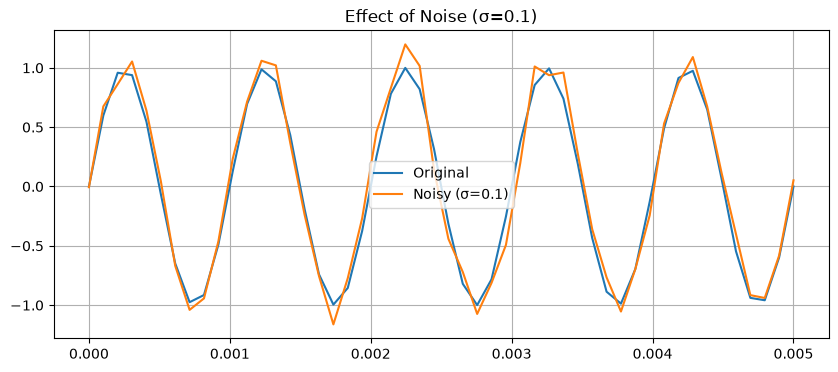 | 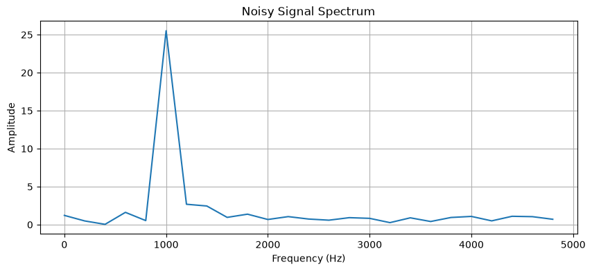 |
| 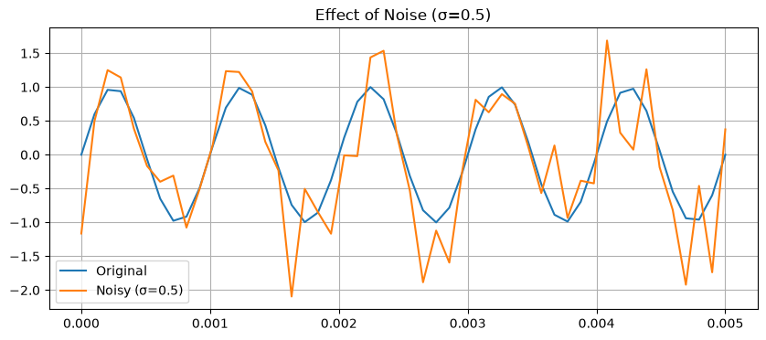 | 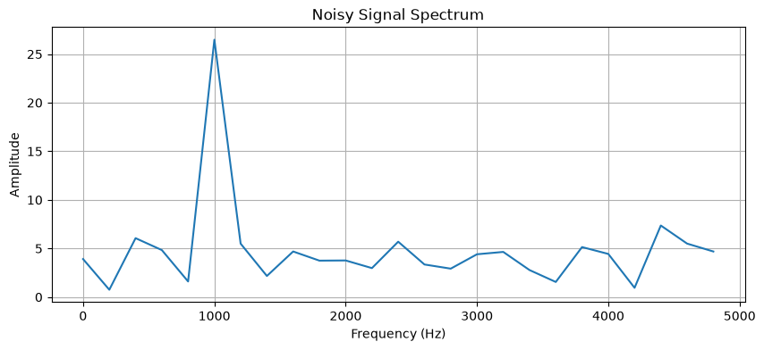 |
| 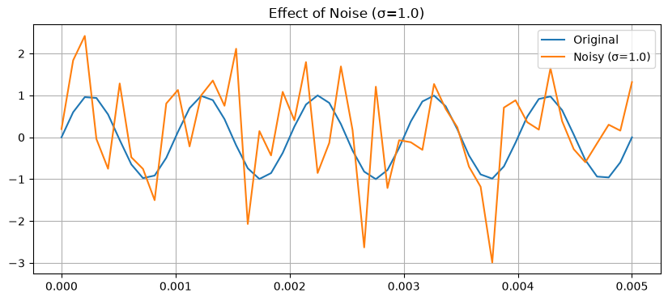 | 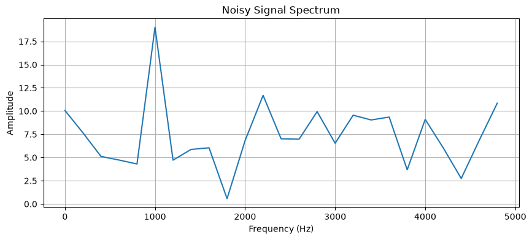 |

* **Task & Question:** *Vary $\sigma$ (0.1, 0.5, 1.0) and observe. Why can the FFT still recover the main frequency under noise?*
* **Answer:** As $\sigma$ increases, the time-domain signal becomes much noisier and harder to read. However, the FFT can still show the main frequency because the sine wave concentrates its energy at $1\text{ kHz}$ to form a sharp peak, while the random noise is spread across all frequencies.

---

### Step 5 – Delay
We introduce a time shift by shifting the signal by 20 samples (`delay = 20`, which is $2\text{ ms}$).

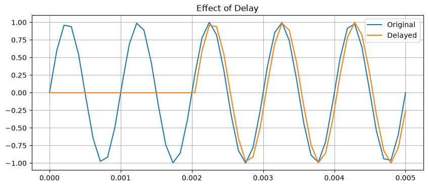

* **Question:** *Give a real example where delay is significant.*
* **Answer:** Satellite communication is a good example because the signal has to travel very long distances up to the satellite and back, which creates a noticeable delay during phone calls, video calls, or internet browsing.

---

### Step 6 – Combined Channel
We combine all three effects: attenuation (0.6), noise ($\sigma = 0.3$), and delay (10 samples, $1\text{ ms}$).

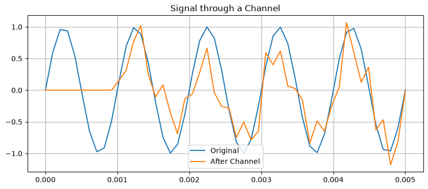

* **Question:** *Compare the original and received signals.*
* **Answer:** The received signal is weaker (smaller amplitude), delayed in time (shifted to the right), and distorted by noise compared to the clean original sine wave.

---

### Step 7 – Square Wave Variant
We generate a $1\text{ kHz}$ square wave using `np.sign(np.sin(2*np.pi*f*t))`.

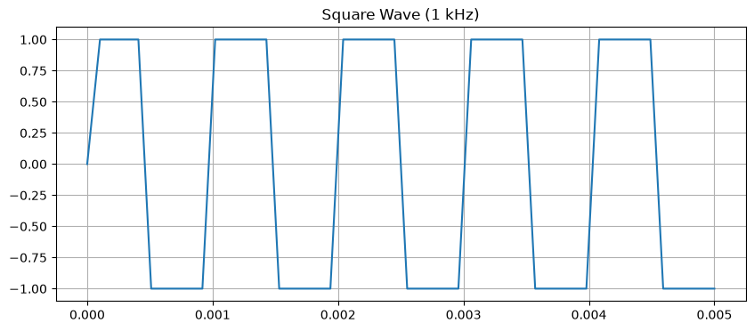

* **Question:** *Why does a square wave require more bandwidth than a sine wave?*
* **Answer:** A pure sine wave is smooth and exists at only one single frequency ($1\text{ kHz}$), so it uses minimal bandwidth. In contrast, a square wave has sharp, instant transitions between -1 and +1. To create these sharp edges, it is made of the base frequency plus many higher odd harmonics ($3\text{ kHz}, 5\text{ kHz}, 7\text{ kHz}, \dots$). Because these higher frequency components spread across a much wider frequency range, transmitting a square wave requires significantly more bandwidth.

---

## 2. Conclusion
1. In this lab, we simulated the basics of signal transmission and channel effects using Python.
2. We visualized sine waves in time and observed their dominant frequency using the FFT.
3. We tested the three main channel impairments: attenuation weakens amplitude, noise adds random variations, and delay shifts the signal in time.
4. The FFT proved effective under noise because the sine wave peak stays clear while noise spreads across frequencies.
5. Combining all three effects showed how real wireless channels degrade signals by making them weaker, noisy, and delayed.
6. Finally, we saw that square waves require much more bandwidth than sine waves due to their harmonics.
