# Wireless Communication Networks and Systems
## Lab 02 Report: Transmission Impairments and Noise
**Student:** BELHIMER Mohmaed Ayoub  
**Simulation:** Python (NumPy, Matplotlib)

---

## 1. Experimental Results & Answers to Questions

### Step 1 — Reference Signals (Clean)
We generate two baseline reference signals at $f_0 = 200\text{ Hz}$ sampled at $f_s = 10000\text{ Hz}$ over $T = 0.05\text{ s}$ ($N = 500$ samples):
1. **Single-Tone Sine ("Analog" Reference):** $s(t) = \sin(2\pi f_0 t)$
2. **Square Wave ("Digital-Like" Reference):** $\text{sign}(\sin(2\pi f_0 t))$

| Time Domain (First 10 ms) | Frequency Domain (Spectrum) |
| :---: | :---: |
| 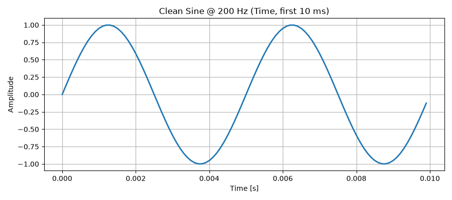 | 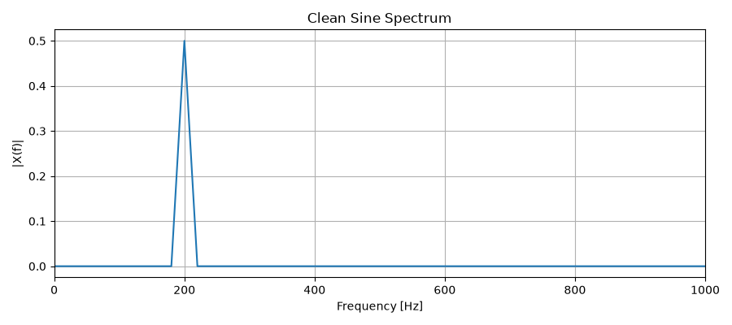 |
| 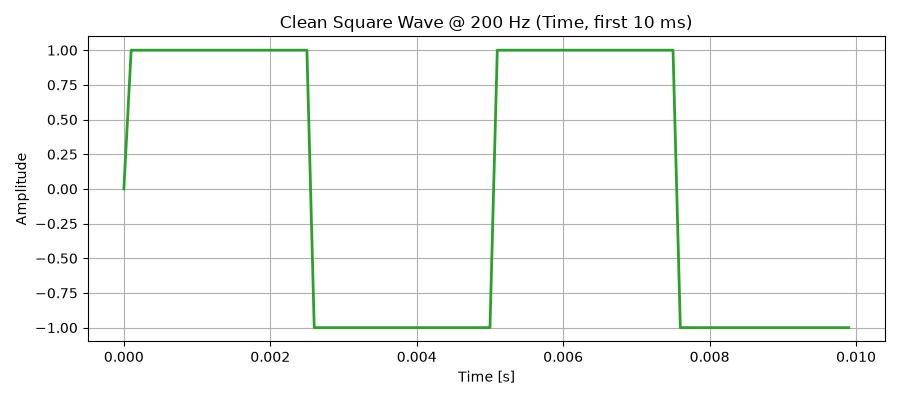 | 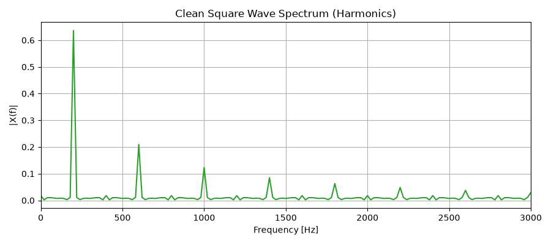 |

* **Observation:** The single-tone sine wave concentrates all its energy at a single frequency ($200\text{ Hz}$). In contrast, the square wave occupies much more bandwidth due to an infinite series of odd harmonics ($200\text{ Hz}, 600\text{ Hz}, 1000\text{ Hz}, 1400\text{ Hz}, \dots$).

---

### Step 2 — Attenuation
We simulate signal power loss over distance (free-space attenuation) by scaling amplitude: `atten = 0.3` (`sine_att = 0.3 * sine`).

| Time Domain (Clean vs. Attenuated) | Frequency Domain (Spectrum) |
| :---: | :---: |
| 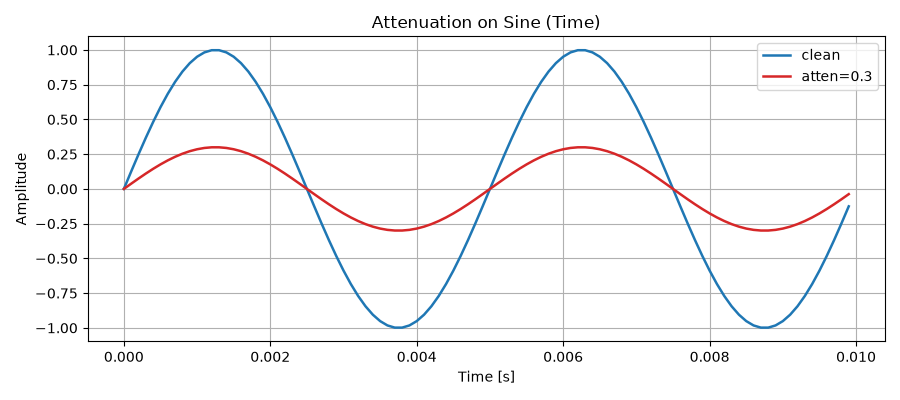 | 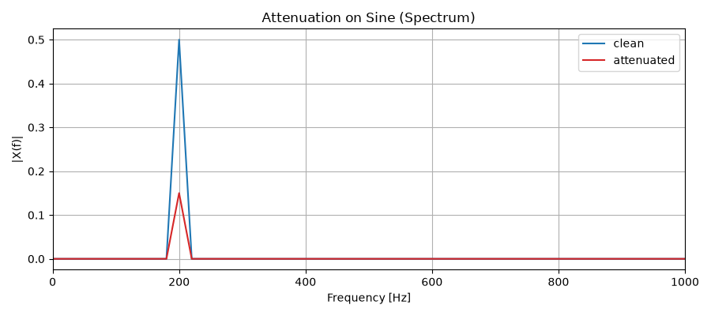 |

* **Key Point:** Attenuation reduces the amplitude and power of the signal uniformly across all frequencies without altering its frequency content or spectral shape.

---

### Step 3 — Distortion (Limited Bandwidth)
We simulate transmission over a band-limited channel by applying a length-$M$ moving average low-pass filter ($M = 31$) to the digital square wave.

| Time Domain (Edges Rounded) | Frequency Domain (Harmonics Suppressed) |
| :---: | :---: |
| 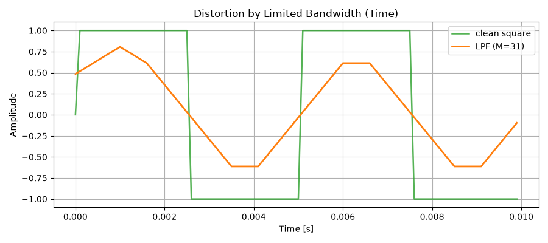 | 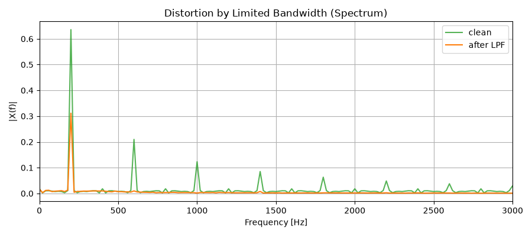 |

* **Key Point:** Limited channel bandwidth suppresses higher-order harmonics, rounding the steep edges and transitions of the signal and causing severe waveform distortion.

---

### Step 4 — Delay and Simple Multipath
We model a two-path multipath channel consisting of a direct line-of-sight ray ($a_1 = 1.0$) and a delayed reflected echo ($a_2 = 0.5$) with a propagation delay of $D = 1\text{ ms}$ (10 samples).

| Multipath on Sine Wave | Multipath on Square Wave (ISI) |
| :---: | :---: |
| 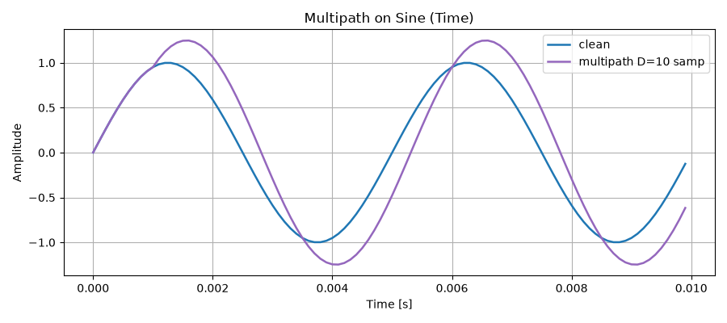 | 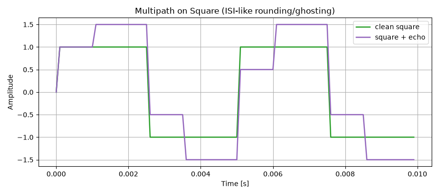 |

* **Key Point:** Multipath propagation introduces delayed and scaled replicas of the signal. These copies interfere constructively and destructively, altering the sine amplitude/phase and causing stepped "ghosting" and inter-symbol interference (ISI) on digital square waves.

---

### Step 5 — Additive White Gaussian Noise (AWGN) and SNR
We inject Additive White Gaussian Noise (AWGN) to evaluate transmission robustness at target Signal-to-Noise Ratios ($\text{SNR} = 0, 6, 12\text{ dB}$).

| Time Domain (Noisy Signal) | Frequency Domain (Spectrum & Noise Floor) |
| :---: | :---: |
| 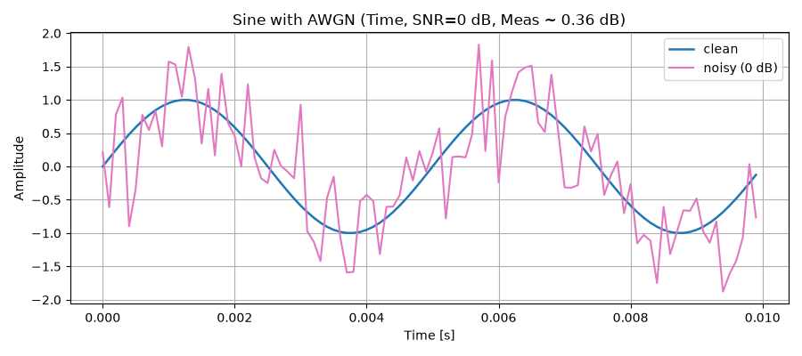 | 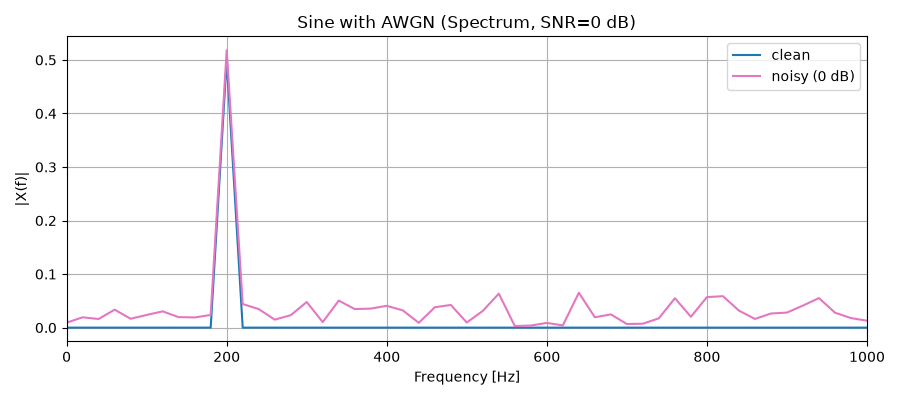 |
| 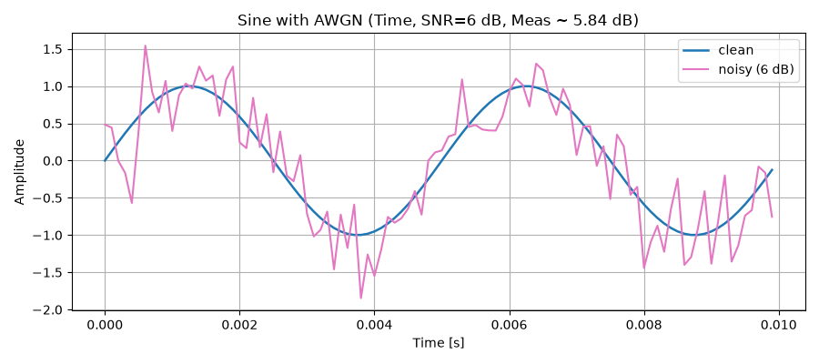 | 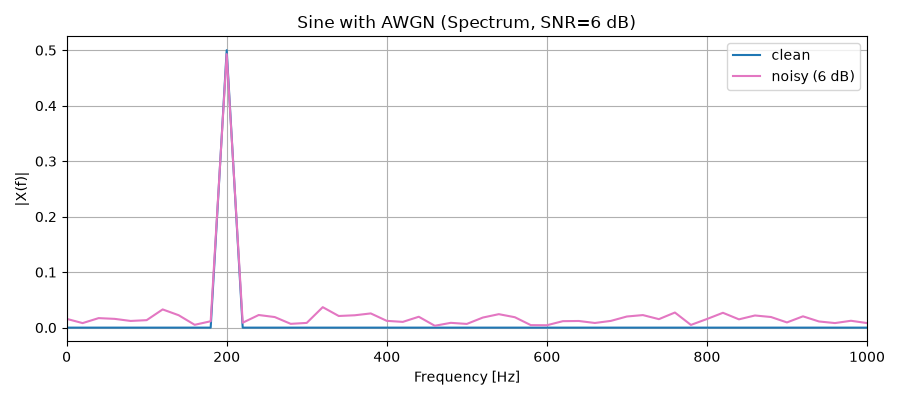 |
| 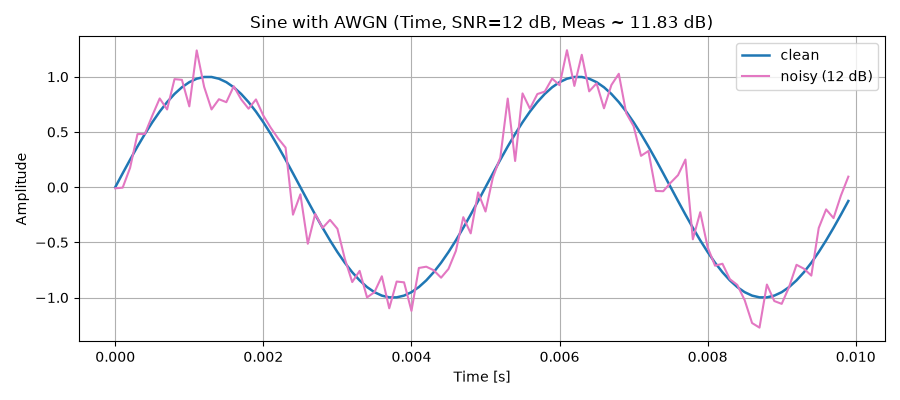 | 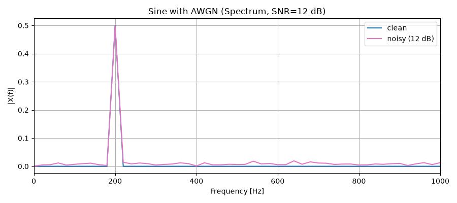 |

* **Mini-exercise:** *Repeat for $\text{SNR} = 0, 6, 12\text{ dB}$ and comment how the tone peak emerges above the noise floor.*
* **Observation / Answer:** At 0 dB, the noise floor is high and the 200 Hz tone peak is barely distinguishable above the random noise. As SNR increases to 6 dB and 12 dB, the noise floor drops significantly and the 200 Hz tone peak clearly emerges above the noise floor.

---

### Step 6 — Combined Channel (Attenuation + Distortion + Delay + Noise)
We pass the digital square wave through a realistic wireless channel combining:
1. **Attenuation:** Gain $A = 0.6$
2. **Bandwidth Limitation:** $M = 21$ low-pass moving average filter
3. **Multipath Reflection:** Echo delay $D = 0.7\text{ ms}$ (7 samples), gain $a_2 = 0.4$
4. **AWGN Noise:** $\text{SNR} = 8\text{ dB}$

| Time Domain (Clean vs. After Channel) | Frequency Domain (Clean vs. After Channel) |
| :---: | :---: |
| 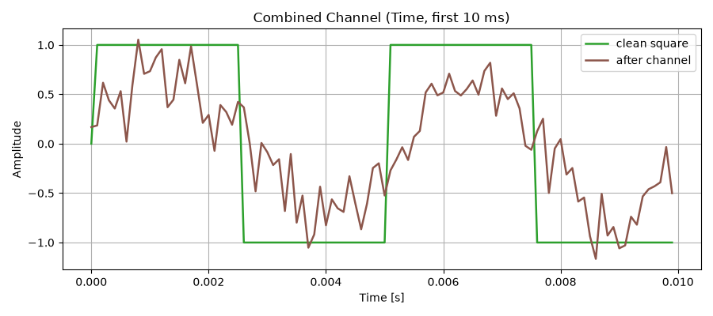 | 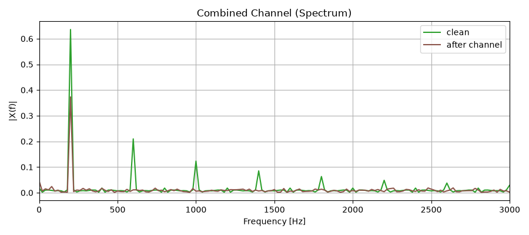 |

* **Reflection:** *Which impairment had the largest visual impact on shape? Which mainly reduced power? How would a symbol detector be affected?*
* **Answer:** Limited bandwidth (distortion) and multipath delay had the largest visual impact on shape by rounding sharp edges and adding echo ripples. Attenuation mainly reduced power without altering the waveform shape. A symbol detector would suffer from inter-symbol interference (ISI) and a reduced noise margin, significantly increasing the bit error rate (BER).

---

### Discussion Questions

* **Question 1:** *Which impairment reduces amplitude without changing spectral shape? Why?*
* **Answer:** Attenuation. It scales the signal by a constant factor across all frequencies, reducing amplitude and power uniformly without altering the frequency content or relative spectral proportions.

* **Question 2:** *Why does limited bandwidth distort square waves more than sines?*
* **Answer:** A sine wave consists of a single frequency, so it passes undistorted if within the channel bandwidth. A square wave is composed of a fundamental frequency plus infinite odd harmonics; limited bandwidth attenuates or removes these high-frequency harmonics, rounding the sharp transitions and distorting the waveform.

* **Question 3:** *How does multipath cause inter-symbol interference (ISI)?*
* **Answer:** Multipath causes delayed copies (echoes) of transmitted symbols to arrive at the receiver over multiple paths. These delayed copies overlap and interfere with subsequent symbols, causing constructive and destructive interference that blurs symbol boundaries and creates ISI.

* **Question 4:** *In the spectrum plots with noise, why is the tone still visible at moderate SNR?*
* **Answer:** The sinusoidal tone concentrates all its energy into a single narrow frequency bin, producing a sharp spectral peak, while white noise spreads its power evenly across all frequencies. At moderate SNR, this tone peak remains well above the average noise floor.

* **Question 5:** *Give a real-world situation where delay is significant (e.g., GEO satellites).*
* **Answer:** Geostationary Earth Orbit (GEO) satellite communication. Because satellites orbit at roughly 36,000 km, the round-trip propagation delay is approximately 500 ms, causing noticeable latency in real-time voice calls, video conferencing, and online gaming.

---

## 2. Conclusion
1. We successfully modeled and analyzed the four fundamental wireless transmission impairments: attenuation, distortion, multipath delay, and additive noise.
2. Attenuation scales signal amplitude and power equally across all frequencies without distorting the spectral shape.
3. Bandwidth limits act as low-pass filters, eliminating high-frequency harmonics and smoothing sharp digital edges, which leads to pulse dispersion.
4. Multipath propagation creates echo interference and phase distortion, directly causing inter-symbol interference (ISI) in digital signals.
5. In the frequency domain, narrowband tones remain detectable even under moderate noise levels because sinusoidal power concentrates in a single frequency bin while AWGN spreads over the full bandwidth.
6. The combined channel simulation demonstrates how these impairments jointly degrade signal integrity, motivating the necessity of channel equalization, pulse shaping, and forward error correction (FEC) in modern wireless communications.

