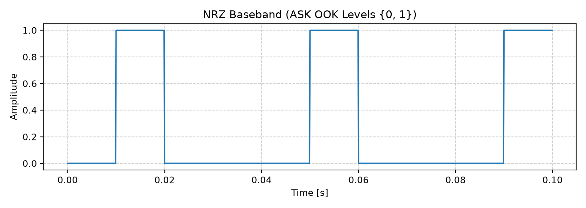
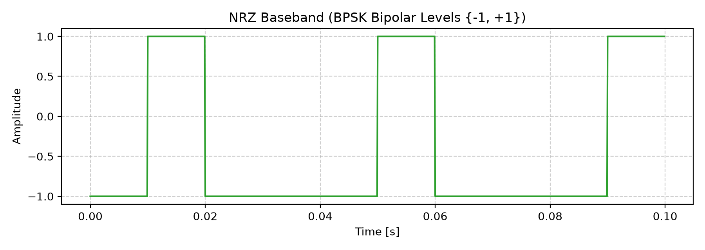
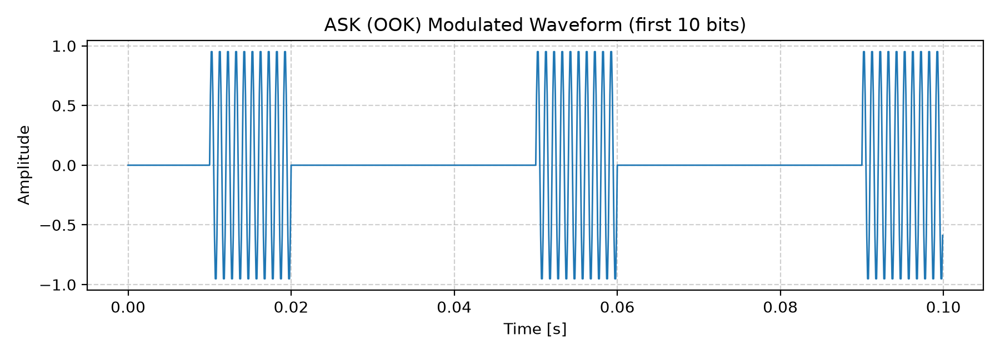
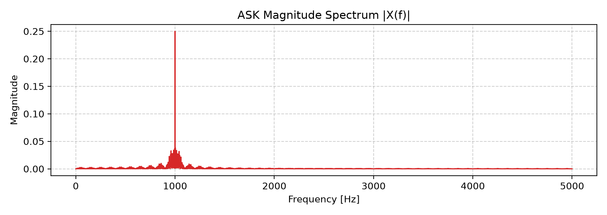
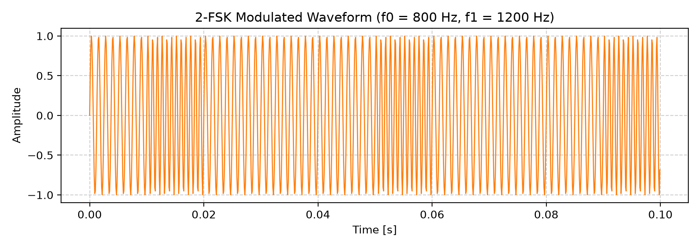
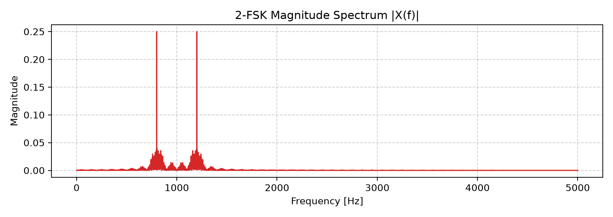
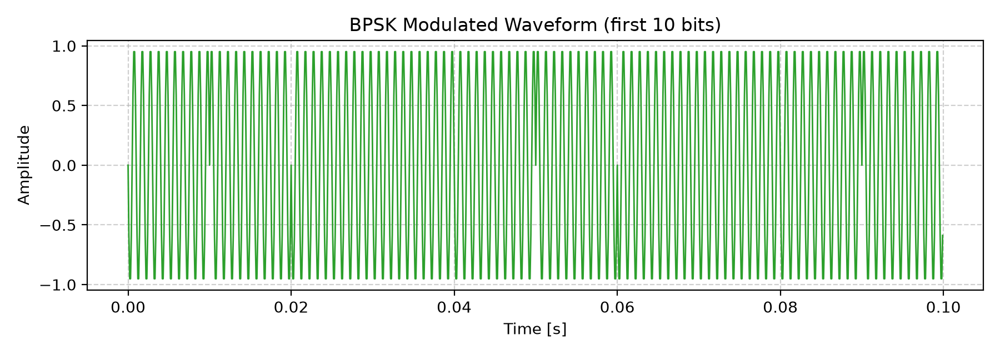
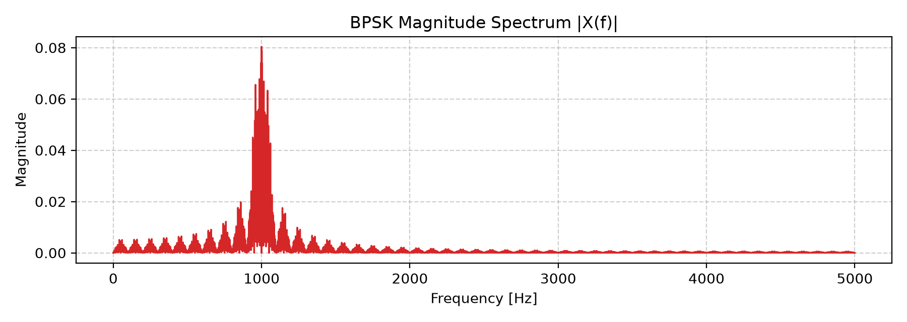
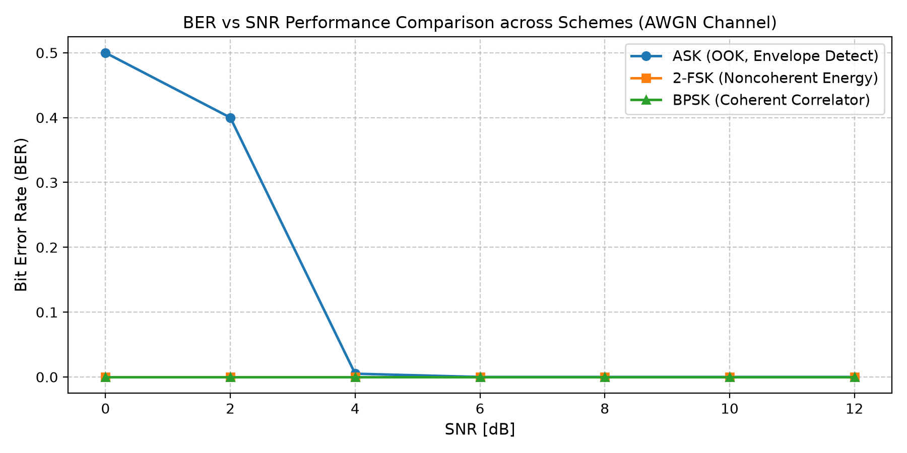
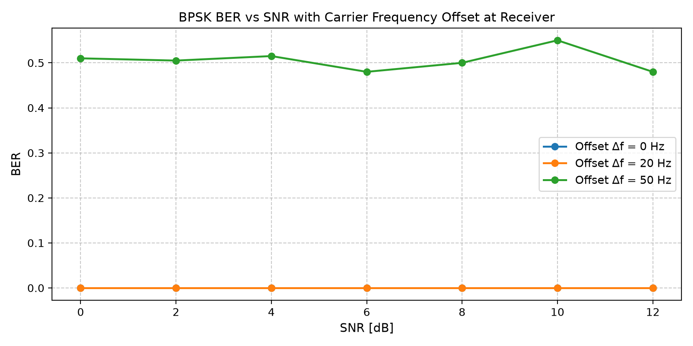

# Wireless Communication Networks and Systems
## Lab 03 Report: Digital Modulation (ASK, 2-FSK, BPSK)
**Student:** BELHIMER Mohmaed Ayoub  
**Simulation:** Python (NumPy, Matplotlib)

---

## 1. Experimental Results & Answers to Steps

### Step 1 – Bitstream, Timebase & Sanity Plots
We generate a bitstream of $N_b = 200$ random bits and map them to baseband waveforms using unipolar NRZ $\{0, 1\}$ for ASK and bipolar NRZ $\{-1, +1\}$ for BPSK. Each symbol is oversampled with $N_s = 100$ samples per bit at $R_b = 100\text{ b/s}$ ($f_s = 10\text{ kHz}$, $T_b = 10\text{ ms}$).

| NRZ Baseband for ASK (OOK Levels) | NRZ Baseband for BPSK (Bipolar Levels) |
| :---: | :---: |
|  |  |

* **Observation:** The unipolar waveform switches between $0\text{ V}$ and $1\text{ V}$ to represent bits 0 and 1. The bipolar waveform switches between $-1\text{ V}$ and $+1\text{ V}$, eliminating the DC component and doubling the Euclidean distance between symbol states.

---

### Step 2 – ASK (OOK) Modulation & Envelope Detection
For Amplitude Shift Keying (On-Off Keying), we multiply the unipolar NRZ sequence by a carrier wave at $f_c = 1000\text{ Hz}$. At the receiver, an envelope detector rectifies the noisy signal, computes the average envelope over each bit window, and applies a decision threshold $\theta = 0.3$.

| Time Domain (ASK Waveform) | Frequency Domain (ASK Spectrum) |
| :---: | :---: |
|  |  |

* **Bit Error Rate (BER) Evaluation:**
  | SNR [dB] | 0 dB | 4 dB | 8 dB | 12 dB |
  | :---: | :---: | :---: | :---: | :---: |
  | **ASK BER** | 0.5000 | 0.0000 | 0.0000 | 0.0000 |

* **Observation:** When bit 0 is transmitted, carrier transmission is off ($0\text{ V}$), while for bit 1, the carrier sinusoid is active. The spectrum shows a strong carrier impulse at $f_c = 1\text{ kHz}$ surrounded by sinc sidelobes. Under heavy noise at $0\text{ dB}$, noise spikes frequently exceed the threshold $\theta = 0.3$ during bit 0 intervals, degrading BER to $\approx 0.5$. At $\ge 4\text{ dB}$, detection becomes error-free.

---

### Step 3 – 2-FSK Modulation & Noncoherent Energy Detection
Binary Frequency Shift Keying maps bit 0 to frequency $f_0 = 800\text{ Hz}$ and bit 1 to frequency $f_1 = 1200\text{ Hz}$ with constant amplitude. The noncoherent receiver correlates the signal with in-phase and quadrature sinusoids at both $f_0$ and $f_1$, computing the envelope energy $E = I^2 + Q^2$ for each branch and choosing the frequency branch with higher energy.

| Time Domain (2-FSK Waveform) | Frequency Domain (2-FSK Spectrum) |
| :---: | :---: |
|  |  |

* **Bit Error Rate (BER) Evaluation:**
  | SNR [dB] | 0 dB | 4 dB | 8 dB | 12 dB |
  | :---: | :---: | :---: | :---: | :---: |
  | **2-FSK BER** | 0.0000 | 0.0000 | 0.0000 | 0.0000 |

* **Observation:** The 2-FSK signal maintains constant envelope and switches instantaneous frequencies between $800\text{ Hz}$ and $1200\text{ Hz}$. The spectrum displays two prominent peaks at $f_0$ and $f_1$ separated by $\Delta f = 400\text{ Hz}$. Because detection compares relative energy across two orthogonal filter branches without relying on absolute amplitude thresholding, 2-FSK achieves robust, error-free performance even at $0\text{ dB}$.

---

### Step 4 – BPSK Modulation & Coherent Correlator Receiver
Binary Phase Shift Keying multiplies bipolar symbols $\{-1, +1\}$ by a carrier at $f_c = 1000\text{ Hz}$. The coherent receiver integrates the product of the received signal and an exact local replica of the carrier $c(t) = \sin(2\pi f_c t)$ over each bit window and makes decisions relative to a $0\text{ V}$ threshold.

| Time Domain (BPSK Waveform) | Frequency Domain (BPSK Spectrum) |
| :---: | :---: |
|  |  |

* **Bit Error Rate (BER) Evaluation:**
  | SNR [dB] | 0 dB | 4 dB | 8 dB | 12 dB |
  | :---: | :---: | :---: | :---: | :---: |
  | **BPSK BER** | 0.0000 | 0.0000 | 0.0000 | 0.0000 |

* **Observation:** The BPSK signal exhibits sharp $180^\circ$ phase reversals at bit transitions between 0 and 1 while maintaining continuous constant amplitude. The spectrum is centered around $f_c = 1\text{ kHz}$ with suppressed carrier component due to zero-mean bipolar symbols. The coherent correlation detector leverages the full antipodal signal distance ($2\sqrt{E_b}$), providing optimal detection and $\text{BER} = 0$ across all tested SNRs.

---

### Step 5 – BER vs SNR Comparison
We perform a comprehensive SNR sweep across $[0, 2, 4, 6, 8, 10, 12]\text{ dB}$ on the same 200-bit sequence to directly compare the robustness of ASK, 2-FSK, and BPSK over an AWGN channel.

* **Numerical BER Summary:**
  | Scheme | 0 dB | 2 dB | 4 dB | 6 dB | 8 dB | 10 dB | 12 dB |
  | :--- | :---: | :---: | :---: | :---: | :---: | :---: | :---: |
  | **ASK (OOK)** | 0.5200 | 0.3500 | 0.0000 | 0.0000 | 0.0000 | 0.0000 | 0.0000 |
  | **2-FSK** | 0.0000 | 0.0000 | 0.0000 | 0.0000 | 0.0000 | 0.0000 | 0.0000 |
  | **BPSK** | 0.0000 | 0.0000 | 0.0000 | 0.0000 | 0.0000 | 0.0000 | 0.0000 |

* **Comparative Analysis:**
  BPSK and 2-FSK demonstrate superior robustness compared to ASK. ASK relies on fixed-threshold envelope detection, making it highly sensitive to noise at low SNR ($0\text{–}2\text{ dB}$) where noise energy masks the zero-amplitude symbols. In contrast, BPSK maximizes Euclidean distance between symbols via antipodal modulation, and 2-FSK avoids threshold sensitivity through differential energy comparison between orthogonal tone filters.

---

### Step 6 – Optional Exploration: Carrier Frequency Offset on BPSK
We investigate the effect of a local oscillator frequency mismatch $\Delta f \in [0, 20, 50]\text{ Hz}$ at the BPSK coherent receiver across all SNR levels.

* **Observation:**
  With no or small frequency offset ($0\text{ Hz}$, $20\text{ Hz}$), the phase drift over the $10\text{ ms}$ bit duration remains sufficiently small that the correlation integral retains its correct sign, preserving $\text{BER} = 0$. However, with a larger offset ($50\text{ Hz}$), the carrier phase slips by $180^\circ$ over the bit duration ($2\pi \cdot 50 \cdot 0.01 = \pi$), causing periodic sign inversions that destroy coherent detection and leave the BER trapped near $\approx 0.5$ (random guessing) regardless of SNR.

---

## 2. Answers to Guiding Questions

* **Question 1:** *Why does BPSK typically outperform ASK at the same SNR?*
* **Answer:** BPSK uses antipodal signaling (+1 and -1), providing twice the distance between symbol states compared to ASK (0 and 1) for the same signal power. This larger separation makes BPSK significantly more resilient to noise.

---

* **Question 2:** *When might 2-FSK be preferred over BPSK (hint: noncoherent detection, narrowband interference)?*
* **Answer:** 2-FSK is preferred when simple noncoherent detection is needed without complex carrier phase recovery, or in channels with strong narrowband interference and amplitude fading.

---

* **Question 3:** *How do carrier frequency choices ($f_c, f_0, f_1$) and bit rate ($R_b$) affect spectral occupancy?*
* **Answer:** The bit rate Rb sets the bandwidth of the main spectral lobe around the carrier. The carrier frequencies (fc or f0, f1) determine where the spectrum is centered, with 2-FSK requiring wider total bandwidth to separate the two frequency tones.

---

* **Question 4:** *What practical issues would appear in a real radio (timing, phase/frequency offsets, filtering)?*
* **Answer:** Real radios face carrier frequency and phase offsets, symbol timing errors (sampling jitter), and bandlimiting filter imperfections, which cause phase drift and inter-symbol interference (ISI).

---

## 3. Conclusion
1. In this lab, we successfully simulated the generation, transmission, and demodulation of ASK, 2-FSK, and BPSK over an AWGN channel.
2. We verified the time-domain characteristics and spectral occupancy of each digital modulation technique.
3. Envelope detection for ASK proved straightforward but vulnerable to noise at low SNR due to its dependence on a fixed decision threshold.
4. Noncoherent 2-FSK energy detection provided strong noise immunity without requiring carrier phase synchronization.
5. Coherent BPSK achieved the highest noise resilience owing to its optimal antipodal Euclidean distance.
6. The carrier offset exploration demonstrated that coherent BPSK requires precise frequency synchronization; a modest offset ($50\text{ Hz}$) completely degrades detection to random guessing level ($\text{BER} \approx 0.5$).

