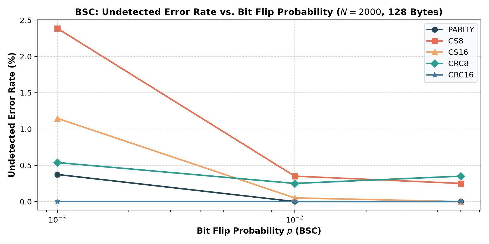
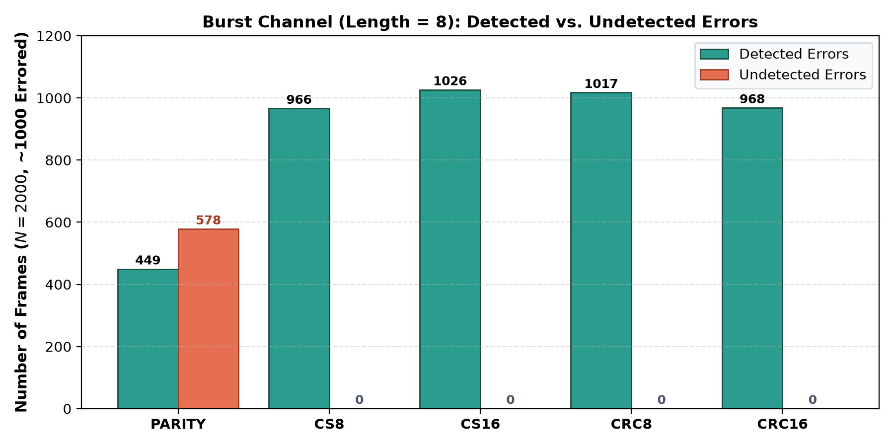
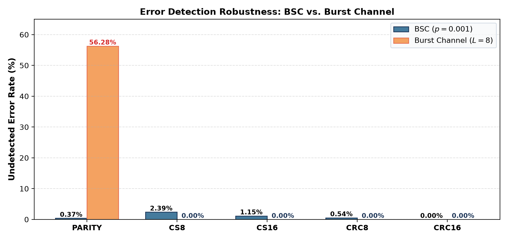
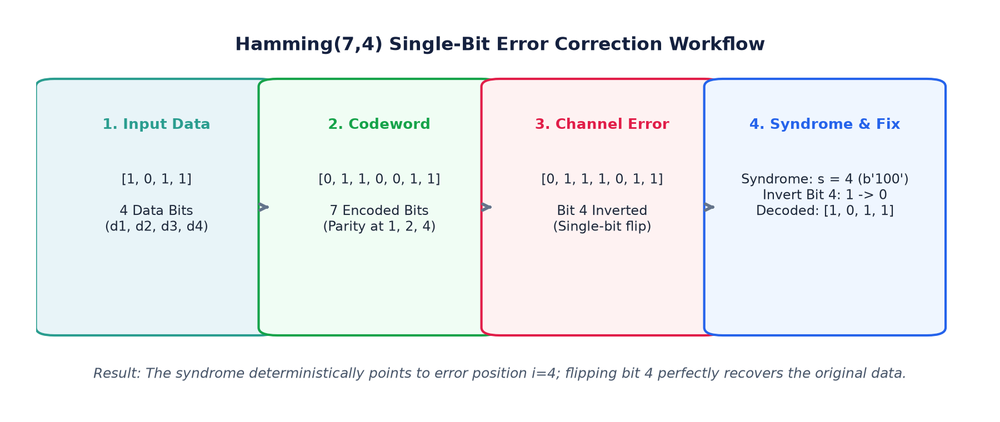

# Wireless Communication Networks and Systems
## Lab 04 Report: Error Detection & Coding
**Student:** BELHIMER Mohmaed Ayoub  
**Simulation:** Python (NumPy, Matplotlib)

---

## 1. Experimental Results & Answers to Steps

### Step 1 – Parity Bit (Even/Odd)
We implement byte-wise even parity by adding 1 parity bit to each 8-bit byte so that the total number of 1s in the 9-bit word is even. We transmit a 16-byte text payload across a BSC channel with $p = 0.02$.

* **Quick Test Output:**
  ```text
  Parity check passed: False
  ```
* **Observation / Answer:**
  * Parity only checks if the total count of 1s is even or odd.
  * If **1 bit flips**, the parity changes, so the error is easily detected.
  * But if **2 bits flip** in the same byte, the total count of 1s changes by +2, -2, or 0. The total remains even, so the parity check passes and the errors go completely undetected. In general, parity misses any **even number of bit errors** in a byte.

---

### Step 2 – Simple Checksums (8-Bit Modular & 16-Bit Ones' Complement)
We implement two arithmetic checksums:
1. **8-Bit Modular Sum:** Adds all bytes modulo 256 (`sum(payload) & 0xFF`) and appends the 1-byte sum.
2. **16-Bit Ones' Complement Checksum (Internet style):** Adds 16-bit words with end-around carry and appends the inverted sum (`(~s) & 0xFFFF`).

* **Observation / Answer:**
  * Checksums simply add numbers together, which leads to common misses:
  * **Compensating errors:** If one bit flips from $0 \to 1$ (+1) in one byte and another bit flips from $1 \to 0$ (-1) in another byte, the changes cancel out and the sum stays the same.
  * **Order doesn't matter:** Because addition is commutative ($A + B = B + A$), swapping the order of two bytes does not change the checksum.
  * Adding zeros or flipping between $+0$ (`0x0000`) and $-0$ (`0xFFFF`) in ones' complement also goes undetected.

---

### Step 3 – Cyclic Redundancy Check (CRC-8 & CRC-16)
We implement a bitwise CRC engine using polynomial division over GF(2):
* **CRC-8:** Generator polynomial $G(x) = x^8 + x^2 + x + 1$ (`0x07`).
* **CRC-16-CCITT:** Generator polynomial $G(x) = x^{16} + x^{12} + x^5 + 1$ (`0x1021`, init `0xFFFF`).

* **Key Detection Capabilities:**
  * **Single and double bit errors:** The math is designed so that 1-bit and 2-bit error patterns never divide evenly into the generator polynomial, so they are always detected.
  * **Any odd number of errors:** Caught because the polynomial has $(x+1)$ as a factor.
  * **Burst errors:** Any burst of errors up to the degree of the polynomial (up to 8 bits for CRC-8, and up to 16 bits for CRC-16) is 100% guaranteed to be detected.

---

### Step 4 – Monte Carlo Detection Performance: BSC vs. Burst Channel
As specifically required by the teacher, we evaluate and compare the five error-detection methods (`parity`, `cs8`, `cs16`, `crc8`, `crc16`) under both channel models using $N = 2000$ trials with a $128$-byte payload ($1024$ data bits).

#### 1. Binary Symmetric Channel (BSC) Simulation Results
Bits flip independently with probability $p \in \{0.001, 0.01, 0.05\}$:

```text
=== Channel: bsc | N=2000 | payload=128 bytes ===
       p  scheme  clean  errored  detected  undetected  undet_rate
   0.001  parity    663     1337      1332           5      0.0037
   0.001     cs8    724     1276      1248          28      0.0219
   0.001    cs16    694     1306      1297           9      0.0069
   0.001    crc8    695     1305      1300           5      0.0038
   0.001   crc16    744     1256      1256           0      0.0000
   0.010  parity      0     2000      2000           0      0.0000
   0.010     cs8      0     2000      1989          11      0.0055
   0.010    cs16      0     2000      1998           2      0.0010
   0.010    crc8      0     2000      1992           8      0.0040
   0.010   crc16      0     2000      2000           0      0.0000
   0.050  parity      0     2000      2000           0      0.0000
   0.050     cs8      0     2000      1995           5      0.0025
   0.050    cs16      0     2000      2000           0      0.0000
   0.050    crc8      0     2000      1996           4      0.0020
   0.050   crc16      0     2000      2000           0      0.0000
```

#### 2. Burst Channel Simulation Results
Frames are subjected to burst errors of length $L = 8$ contiguous bits with burst probability $P_{\text{burst}} = 0.5$:

```text
=== Channel: burst | N=2000 | payload=128 bytes ===
       p  scheme  clean  errored  detected  undetected  undet_rate
   0.001  parity   1015      985       441         544      0.5523
   0.001     cs8   1016      984       984           0      0.0000
   0.001    cs16    995     1005      1005           0      0.0000
   0.001    crc8   1026      974       974           0      0.0000
   0.001   crc16   1035      965       965           0      0.0000
   0.010  parity   1025      975       419         556      0.5703
   0.010     cs8   1013      987       987           0      0.0000
   0.010    cs16   1016      984       984           0      0.0000
   0.010    crc8   1010      990       990           0      0.0000
   0.010   crc16    986     1014      1014           0      0.0000
   0.050  parity   1009      991       434         557      0.5621
   0.050     cs8   1002      998       998           0      0.0000
   0.050    cs16   1010      990       990           0      0.0000
   0.050    crc8   1003      997       997           0      0.0000
   0.050   crc16    972     1028      1028           0      0.0000
```

| BSC Detection Performance | Burst Channel Detected vs. Undetected |
| :---: | :---: |
|  |  |



#### 3. Comparing the Methods & Interpreting Results
* **Under Random Bit Errors (BSC):**
  * At low error rate ($p = 0.001$), about $35\%$ of frames are clean and $65\%$ have errors.
  * **Parity** detects almost all errors ($0.37\%$ undetected), failing only when 2 bits flip in the same byte.
  * **CS8** has the highest undetected rate (~$2.2\%$) because random flips across 128 bytes easily cancel out modulo 256.
  * **CS16** is much better (~$0.7\%$ undetected) thanks to its 16-bit sum space.
  * **CRC-8** outperforms CS8 by more than $5\times$ (~$0.4\%$ undetected).
  * **CRC-16 is the best**, catching 100% of errors (**0 undetected**) across all 6000 test frames.
  * At higher error rates ($p = 0.01, 0.05$), every frame has errors. Parity catches 100% because with many errors scattered across the frame, at least one byte is sure to have an odd flip. CS8 still misses about $0.3\%$ of errors due to random collisions ($1/256$).
* **Under Burst Errors (Burst Length = 8):**
  * **Parity fails completely:** Over **$55\%$ of burst errors go undetected**! Because an 8-bit burst flips 8 bits in a row, it flips an even number of bits in the affected bytes, which leaves the parity check unchanged.
  * **Checksums and CRCs catch 100% of burst errors:** `cs8`, `cs16`, `crc8`, and `crc16` caught every single burst error (0 undetected). For CRC-8 and CRC-16, this is mathematically guaranteed: any burst of length $\le 8$ is always caught.

---

### Step 5 – (Optional) Hamming(7,4) Single-Bit Correction
We implement the Hamming(7,4) code, which encodes 4 data bits into 7 codeword bits by inserting 3 parity bits at positions 1, 2, and 4.



* **Quick Demo Output:**
  ```text
  orig: [1, 0, 1, 1] flip_pos: 4 syndrome: 4 decoded: [1, 0, 1, 1]
  ```
* **Observation / Answer:**
  * If **1 bit flips**, the receiver calculates the syndrome, which directly gives the position of the flipped bit (position 4). The receiver simply flips that bit back to restore the original data.
  * If **2 bits flip**, the syndrome still flags that an error happened, but it points to the wrong bit position. Trying to fix it will flip a healthy bit and create a third error. Thus, Hamming(7,4) detects two errors, but can only correct one.

---

## 2. Answers to Guiding Questions

* **Question 1:** *Give an example where parity fails but CRC-16 succeeds. Why?*
* **Answer:**
  * **Example:** If we send `00000000` with an even parity bit `0` and noise flips two bits to `11000000`, the byte has two 1s. Since 2 is even, parity check passes and the error goes completely undetected.
  * **Why CRC-16 succeeds:** CRC-16 treats the bit sequence as a polynomial. Its generator polynomial is designed so that no 2-bit error pattern can divide evenly into it, leaving a remainder that always flags the error.

---

* **Question 2:** *Why does a ones’ complement checksum sometimes miss certain multi-bit patterns?*
* **Answer:**
  * Because checksums just add words together, order and position don't matter:
  * If one bit flips from 0 to 1 in one word (+1) and another bit flips from 1 to 0 in another word (-1), the changes cancel out and the sum stays the same.
  * Swapping two words or having a word flip from all-zeros (`0x0000`) to all-ones (`0xFFFF`) also produces the exact same checksum.

---

* **Question 3:** *How does frame length affect undetected error probability for each scheme?*
* **Answer:**
  * **Parity:** For random noise, longer frames have more bytes, making it more likely that at least one byte has an odd number of errors and gets caught. But for burst errors, parity remains bad (~55% undetected) no matter how long the frame is.
  * **Checksums:** Longer frames mean more words, so there are more ways for errors to cancel each other out. The undetected rate settles around $1/256$ for 8-bit and $1/65536$ for 16-bit.
  * **CRCs:** Short bursts (up to the CRC size) are always 100% caught, regardless of frame length. For random noise, CRC-16 catches 100% of double errors, and longer random patterns have only a tiny chance ($1/2^{16} \approx 0.0015\%$) of slipping through.

---

* **Question 4:** *In practice, why do protocols combine CRC with FEC (e.g., convolutional/LDPC codes)?*
* **Answer:**
  * They do two different, complementary jobs:
  * **FEC (Forward Error Correction):** Fixes common bit errors on the spot so the system doesn't have to waste time retransmitting packets, keeping speeds high.
  * **CRC:** Acts as a safety check. If the noise is too strong and FEC fails or makes a wrong correction, CRC reliably detects the bad packet so it can be discarded and requested again.
  * Together, FEC provides speed, while CRC guarantees data reliability.

---

## 3. Conclusion
1. In this lab, we evaluated five error-detection methods (parity, 8-bit checksum, 16-bit checksum, CRC-8, CRC-16) and one error-correcting code (Hamming(7,4)).
2. Under random bit noise (BSC), CRC-16 performed the best, catching 100% of errors with **0 undetected** across all tests.
3. Under burst noise, parity failed badly (missing over **55%** of errors) because 8-bit bursts flip an even number of bits in a byte.
4. Checksums and CRCs easily caught all 8-bit burst errors, with CRCs mathematically guaranteeing detection for bursts up to their size.
5. Hamming(7,4) showed how syndrome calculation can locate and correct a single bit flip without needing retransmission.
6. Real wireless systems combine FEC to fix common errors with CRC to catch any remaining bad packets.
