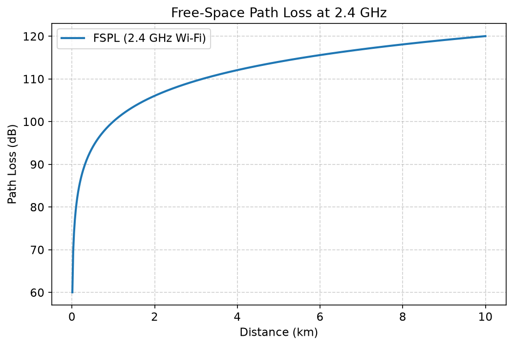
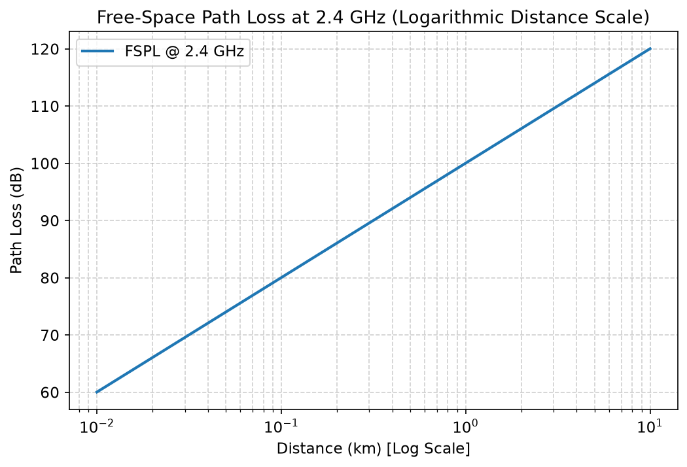
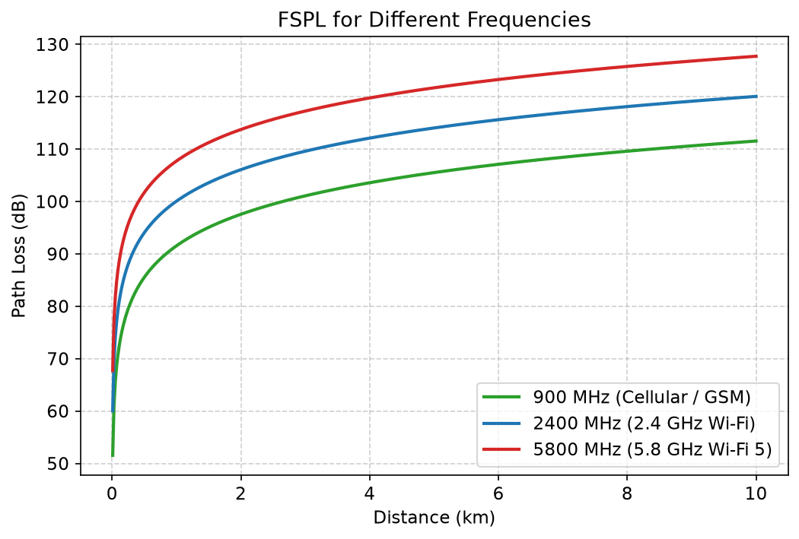
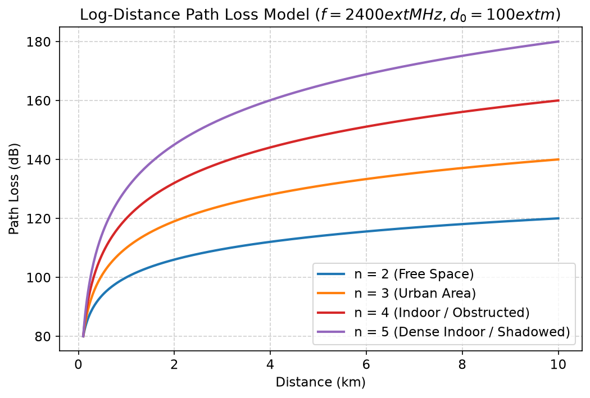
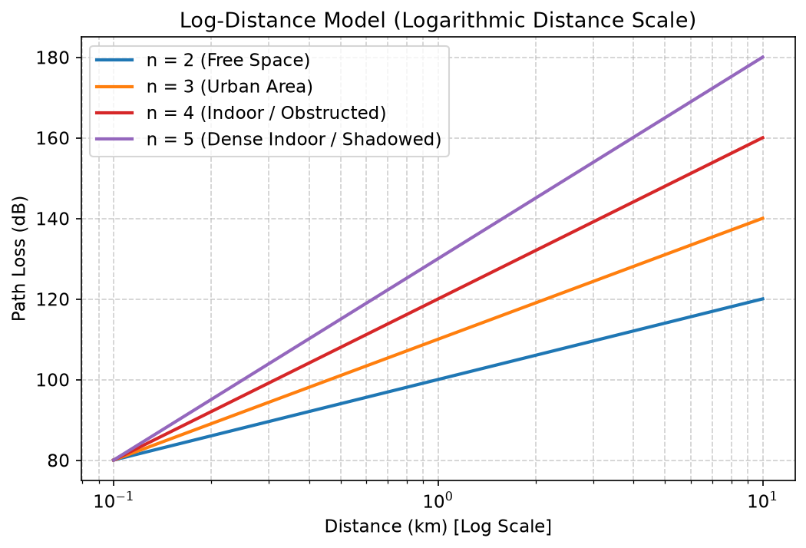
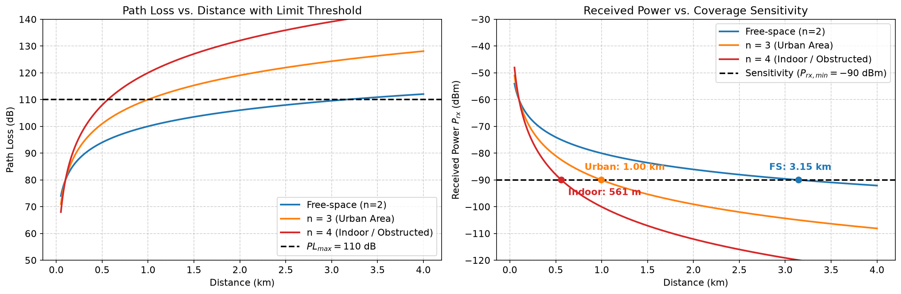

# Wireless Communication Networks and Systems
## Lab 05 Report: Propagation and Path Loss Models
**Student:** BELHIMER Mohmaed Ayoub  
**Simulation:** Python (NumPy, Matplotlib)

---

## 1. Experimental Results & Answers to Steps

### Step 1 – Free-Space Path Loss (FSPL) Formula
We implement Friis' free-space path loss equation for isotropic antennas ($G_t = G_r = 1$):
$$PL_{FS}\text{ (dB)} = 20\log_{10}(d) + 20\log_{10}(f) + 32.44$$
where $d$ is distance in km and $f$ is frequency in MHz. We simulate $f = 2400\text{ MHz}$ (2.4 GHz Wi-Fi) over $d \in [0.01, 10]\text{ km}$ on both linear and logarithmic distance scales.

| Linear Distance Scale | Logarithmic Distance Scale |
| :---: | :---: |
|  |  |

* **Observation:**
  * On a linear scale, path loss rises very rapidly at short distances and then flattens out as distance grows.
  * On a logarithmic distance scale (`semilogx`), FSPL becomes a straight line with a constant slope of **$20\text{ dB/decade}$** — every $10\times$ increase in distance adds exactly $20\text{ dB}$ of attenuation.

---

### Step 2 – Effect of Frequency
We compare FSPL across three wireless bands: **$900\text{ MHz}$** (Cellular/GSM), **$2400\text{ MHz}$** (2.4 GHz Wi-Fi), and **$5800\text{ MHz}$** (5.8 GHz Wi-Fi 5), and compute the exact attenuation at $d = 1.0\text{ km}$.

* **Quantitative Output:**
  ```text
  Path Loss at d = 1.0 km:
    • 900 MHz (Cellular / GSM)      : 91.52 dB
    • 2400 MHz (2.4 GHz Wi-Fi)      : 100.04 dB
    • 5800 MHz (5.8 GHz Wi-Fi 5)    : 107.71 dB

  Additional Path Loss relative to 900 MHz:
    • 2400 MHz vs 900 MHz: +8.52 dB additional attenuation
    • 5800 MHz vs 900 MHz: +16.18 dB additional attenuation
  ```



* **Observation:**
  * All three curves are parallel on the dB scale because the frequency penalty $\Delta PL = 20\log_{10}(f_2 / f_1)$ is constant and independent of distance.
  * Higher frequencies experience significantly higher path loss ($+8.52\text{ dB}$ for $2.4\text{ GHz}$ and $+16.18\text{ dB}$ for $5.8\text{ GHz}$ relative to $900\text{ MHz}$).

---

### Step 3 – Log-Distance Path Loss Model
To capture real-world obstacles, reflections, and scattering, we simulate the empirical Log-Distance model at $f = 2400\text{ MHz}$ with reference distance $d_0 = 0.1\text{ km}$ ($100\text{ m}$, $PL(d_0) = 80.04\text{ dB}$):
$$PL(d) = PL(d_0) + 10n \log_{10}\left(\frac{d}{d_0}\right)$$
for path loss exponents $n \in \{2, 3, 4, 5\}$ over $d \in [0.1, 10]\text{ km}$.

| Linear Distance Scale | Logarithmic Distance Scale |
| :---: | :---: |
|  |  |

* **Observation:**
  * On the logarithmic scale, each environment is a straight line with slope **$10n\text{ dB/decade}$**: $20\text{ dB/dec}$ for Free Space ($n=2$), $30\text{ dB/dec}$ for Urban ($n=3$), $40\text{ dB/dec}$ for Indoor/Obstructed ($n=4$), and $50\text{ dB/dec}$ for Dense Indoor ($n=5$).
  * Higher exponents cause path loss to escalate dramatically with distance, severely limiting signal reach in obstructed environments.

---

### Step 4 – Coverage Estimation (Link Budget)
Given $P_t = +20\text{ dBm}$, receiver sensitivity $P_{rx,min} = -90\text{ dBm}$, and $f = 2400\text{ MHz}$, the maximum allowed path loss is:
$$PL_{max} = P_t - P_{rx,min} = 20 - (-90) = 110\text{ dB}$$

* **Coverage Budget Output:**
  ```text
  === Coverage Budget Calculations ===
  Transmit Power (Pt):             +20.0 dBm
  Receiver Sensitivity (Prx_min):  -90.0 dBm
  Maximum Allowed Path Loss:        110.0 dB

  Propagation Model                Exponent n   Max Distance (km)    Max Distance (m)
  --------------------------------------------------------------------------------
  Free-Space (n=2)                 2            3.146                3146.2         
  n = 3 (Urban Area)               3            0.997                996.6          
  n = 4 (Indoor / Obstructed)      4            0.561                560.9          
  n = 5 (Dense Indoor / Shadowed)  5            0.397                397.3
  ```



* **Observation:**
  * Under ideal free space ($n=2$), the link reaches **$3.146\text{ km}$**.
  * Moving to an urban environment ($n=3$) cuts the range by more than $3\times$ to **$996.6\text{ m}$**, and indoor/obstructed environments ($n=4, 5$) shrink coverage further to **$560.9\text{ m}$** and **$397.3\text{ m}$**.

---

## 2. Answers to Discussion Questions

* **Question 1:** *Why does higher frequency lead to greater path loss?*
* **Answer:**
  * As carrier frequency $f$ increases, the wavelength $\lambda = c/f$ gets shorter. Because an isotropic receiving antenna's effective capture area is proportional to $\lambda^2$ ($A_e = \frac{\lambda^2}{4\pi}$), a higher-frequency antenna intercepts a smaller fraction of the expanding spherical wavefront.
  * Mathematically, $PL_{FS}$ includes $+20\log_{10}(f)$, so **doubling the frequency adds $+6.02\text{ dB}$ of path loss** at the same distance (e.g., $+8.52\text{ dB}$ from $900\text{ MHz}$ to $2400\text{ MHz}$, and $+16.18\text{ dB}$ to $5800\text{ MHz}$).

---

* **Question 2:** *What environmental factors can increase the path loss exponent $n$?*
* **Answer:**
  * **Physical obstructions:** Walls (concrete, brick), floors, furniture, metal structures, and buildings that absorb or block radio waves.
  * **Foliage & terrain:** Trees, wet leaves, hills, and uneven ground.
  * **Multipath & scattering:** Reflections off buildings, vehicles, or indoor surfaces causing destructive interference, plus diffraction around sharp edges.
  * **Clutter & atmospheric density:** Crowded indoor spaces, dense urban canyons, and rain/humidity at higher frequencies.

---

* **Question 3:** *Why do indoor Wi-Fi networks have smaller coverage areas than outdoor cellular networks?*
* **Answer:**
  * **Higher path loss exponent ($n$):** Indoor walls and obstacles push $n$ to $4$–$5$, whereas outdoor cellular links typically have $n \approx 3$ (or $2$ in open areas). Our simulation showed range dropping from $996.6\text{ m}$ ($n=3$) to $560.9\text{ m}$ ($n=4$) and $397.3\text{ m}$ ($n=5$).
  * **Higher carrier frequencies:** Wi-Fi ($2.4\text{ GHz}$ and $5.8\text{ GHz}$) suffers higher free-space loss and weaker wall penetration than lower cellular bands ($700$–$900\text{ MHz}$).
  * **Lower transmit power & antenna height:** Wi-Fi routers are capped at low power ($\sim +20\text{ dBm}$) indoors, while cellular base stations transmit at much higher power ($+40$ to $+46\text{ dBm}$) from tall towers with better line-of-sight.

---

* **Question 4:** *How do transmit power and receiver sensitivity influence coverage distance?*
* **Answer:**
  * Together, they define the **maximum allowed path loss** $PL_{max} = P_t - P_{rx,min}$. Increasing $P_t$ or improving (lowering) $P_{rx,min}$ increases $PL_{max}$ and extends coverage range.
  * Because path loss grows logarithmically as $10n\log_{10}(d/d_0)$, every **$+10n\text{ dB}$** added to the link budget multiplies the maximum coverage distance by **$10\times$** (or doubles distance for every $+6\text{ dB}$ in free space $n=2$, and every $+12\text{ dB}$ indoors $n=4$).

---

## 3. Conclusion
1. In this lab, we simulated Free-Space Path Loss (FSPL), frequency dependence, the empirical Log-Distance model, and link-budget coverage estimation.
2. FSPL grows by **$20\text{ dB/decade}$** with distance, while higher carrier frequencies incur a constant distance-independent penalty ($+8.52\text{ dB}$ at $2.4\text{ GHz}$ and $+16.18\text{ dB}$ at $5.8\text{ GHz}$ compared to $900\text{ MHz}$).
3. Real-world obstacles increase the path loss exponent $n$ from $2$ (free space) to $3$–$5$ (urban/indoor), raising the attenuation slope to $10n\text{ dB/decade}$.
4. With $P_t = +20\text{ dBm}$ and $P_{rx,min} = -90\text{ dBm}$ ($PL_{max} = 110\text{ dB}$), maximum range drops from **$3.146\text{ km}$** in free space to **$996.6\text{ m}$** in urban areas and **$397.3$–$560.9\text{ m}$** indoors, explaining why indoor Wi-Fi cells are much smaller than outdoor cellular cells.
